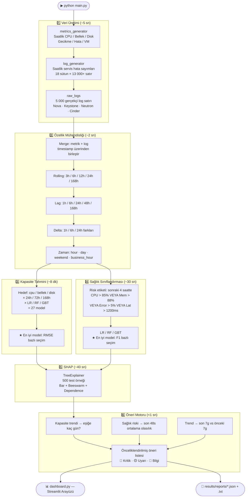

# CloudMon — Bulut Altyapısı Proaktif İzleme ve Karar Destek Sistemi

> **OpenStack ortamları için uçtan uca yapay zekâ destekli izleme platformu.**
> Gerçek zamanlı metrik + log verilerini analiz eder, kapasiteyi 24 / 72 / 168 saat öncesinden tahmin eder,
> sistem sağlık riskini erken uyarı sinyalleriyle tespit eder ve operatöre önceliklendirilmiş aksiyonlar sunar.

---

## İçindekiler

1. [Motivasyon ve Problem Tanımı](#-motivasyon-ve-problem-tanımı)
2. [Sistem Mimarisi](#-sistem-mimarisi)
3. [Pipeline Akışı](#-pipeline-akışı)
4. [Veri Katmanı](#-veri-katmanı)
5. [Özellik Mühendisliği](#-özellik-mühendisliği)
6. [Kapasite Tahmini](#-kapasite-tahmini)
7. [Sağlık Riski Sınıflandırması](#-sağlık-riski-sınıflandırması)
8. [SHAP Açıklanabilirlik](#-shap-açıklanabilirlik)
9. [Öneri Motoru](#-öneri-motoru)
10. [LLM Entegrasyonu](#-llm-entegrasyonu)
11. [Model Performans Sonuçları](#-model-performans-sonuçları)
12. [Proje Yapısı](#-proje-yapısı)
13. [Kurulum ve Çalıştırma](#-kurulum-ve-çalıştırma)
14. [Kritik Eşik Değerleri](#-kritik-eşik-değerleri)
15. [Kullanılan Teknolojiler](#-kullanılan-teknolojiler)
16. [Akademik Literatür Taraması](#-akademik-literatür-taraması)
17. [Özgün Katkılar ve Yenilikçi Yanlar](#-özgün-katkılar-ve-yenilikçi-yanlar)

---

## 🎯 Motivasyon ve Problem Tanımı

### Reaktif İzlemenin Sınırları

Günümüz bulut platformlarının büyük çoğunluğu **eşik değer temelli alarm sistemlerine** dayanır:

```
CPU %85'i geçti  →  alarm tetiklendi  →  operatör müdahale etti
```

Bu yaklaşım **reaktiftir**: sorun *zaten oluştuktan sonra* harekete geçilir.
Sistem yöneticisi yangın söndürür, olayın kök nedenini araştırmak için zaman bulamaz.

### Gerçek Dünya Gözlemi

Çoğu kritik sistem arızası **anlık değildir**. Öncesinde saatler, hatta günler süren
ince sinyaller birikmektedir:

```
Normal  →  [buildup: CPU yavaşça artar]  →  [risk penceresi]  →  KRİTİK ARIZA
           ←──── ML bunu öğrenir ────→        ←── alarm burada ──→
```

CloudMon bu *buildup* örüntülerini makine öğrenmesiyle tespit ederek operatöre
**olay gerçekleşmeden önce** uyarı verir.

### Bu Çalışmanın Katkısı

| Geleneksel Yaklaşım | CloudMon |
|---|---|
| Eşik aşıldığında alarm | Eşiğe kaç gün kaldığını tahmin eder |
| Tek metrik bazlı karar | Metrik + log verisi birleşik analiz |
| Açıklanamayan alarm | SHAP ile "neden alarm?" sorusu yanıtlanır |
| Operatörün tecrübesine bağlı | Önceliklendirilmiş aksiyonlar otomatik üretilir |
| Reaktif | Proaktif |

---

## 🏗️ Sistem Mimarisi

```
╔══════════════════════════════════════════════════════════════════════╗
║                        VERİ KAYNAKLARI                               ║
║                                                                       ║
║   Prometheus / Thanos                  OpenSearch                    ║
║   ┌─────────────────────┐              ┌──────────────────────────┐  ║
║   │  /api/v1/query_range│              │  openstack-logs-* index  │  ║
║   │  CPU · Bellek · Disk│              │  Nova · Keystone         │  ║
║   │  Gecikme · Hata oranı│             │  Neutron · Cinder        │  ║
║   └──────────┬──────────┘              └──────────────┬───────────┘  ║
╚═════════════╪══════════════════════════════════════════╪═════════════╝
              │  saatlik metrikler (9 sütun)            │  log sayımları
              └──────────────────┬──────────────────────┘
                                 │
                                 ▼
              ┌──────────────────────────────────────┐
              │         ÖZELLİK MÜHENDİSLİĞİ         │
              │  rolling · lag · delta · zaman        │
              │  9 ham + 18 log + ~180 türetilmiş     │
              │  ────────────────────────────────     │
              │  Toplam: ~208 özellik sütunu          │
              └──────────────┬───────────────────────┘
                             │
              ┌──────────────┴─────────────────┐
              │                                │
              ▼                                ▼
┌─────────────────────────┐       ┌───────────────────────────┐
│    KAPASİTE TAHMİNİ     │       │   SAĞLIK SINIFLANDIRMASI  │
│                         │       │                           │
│  3 kaynak × 3 ufuk      │       │   Binary (Riskli/Güvenli) │
│  × 3 model = 27 model   │       │   Sonraki 4 saat riski    │
│                         │       │   3 model → F1 ile seçim  │
│  LR · RF · GBT          │       │   LR · RF · GBT           │
│  ★ RMSE ile model seçimi│       │   ★ F1 ile model seçimi   │
└──────────────┬──────────┘       └───────────────┬───────────┘
               │                                  │
               └────────────────┬─────────────────┘
                                │
                                ▼
               ┌────────────────────────────────────┐
               │         SHAP AÇIKLANABILIRLIK       │
               │                                    │
               │   TreeExplainer (test seti 500 ör) │
               │   Bar · Beeswarm · Dependence       │
               │   → Özellik önem sıralaması         │
               └──────────────────┬─────────────────┘
                                  │
                                  ▼
               ┌────────────────────────────────────┐
               │           ÖNERİ MOTORU             │
               │                                    │
               │  Kapasite trendi (72s ekstrapolasyon│
               │  Sağlık riski (48s pencere ort.)    │
               │  Trend bozulması (7g/7g karşılaştırma)│
               │  + SHAP top özelliği                │
               │  → Önceliklendirilmiş öneri listesi │
               └──────────────────┬─────────────────┘
                                  │
                                  ▼
               ┌────────────────────────────────────┐
               │          LLM KATMANI               │
               │                                    │
               │  Claude Sonnet (Anthropic)          │
               │  GPT-4o (OpenAI)                   │
               │  → Aynı bağlam, yan yana yanıt     │
               └────────────────────────────────────┘
```

---

## 🔄 Pipeline Akışı



---

## 📥 Veri Katmanı

### Simülasyon Kapsamı

| Parametre | Değer |
|---|---|
| **Veri aralığı** | Ocak 2025 — Temmuz 2026 (18 ay) |
| **Frekans** | Saatlik (her 60 dakikada bir nokta) |
| **Toplam satır** | ~13 140 saatlik gözlem |
| **Eğitim seti** | Oca 2025 — Mar 2026 (15 ay) |
| **Test seti** | Nis 2026 — Haz 2026 (3 ay) |
| **Tekrarlanabilirlik** | `SEED = 42` |

### Metrik Sinyali Nasıl Üretilir?

Her saatlik metrik değeri 5 bileşenin toplamıdır:

```
değer(t) = taban_değer
         + günlük_örüntü(t)          ← kosinüs: zirve 13:00, dip 04:00
         + haftalık_örüntü(t)        ← hafta sonu %35 düşük yük
         + uzun_vadeli_trend(t)      ← lineer artış (disk: +32 puan/18 ay)
         + incident_etkisi(t)        ← Gauss profil × buildup gecikmesi
         + Gauss_gürültü(t)          ← gerçekçilik için
```

### 15 Tanımlı Incident

Her incident, gerçek OpenStack arızalarından modellenerek üretilmiştir:

| # | Olay | Dönem | CPU Spike | Latency Spike |
|---|---|---|---|---|
| 1 | Kış Stajı Keystone Kimlik Aşırı Yükü | Şub 2025 | +10% | +680 ms |
| 2 | Nova Zamanlayıcı Tıkanması | Mar 2025 | +18% | +540 ms |
| 3 | Disk G/Ç Yavaşlaması | May 2025 | +6% | +820 ms |
| 4 | Yaz Stajı Pik — CPU Baskısı | Tem 2025 | +30% | +820 ms |
| 5 | Yaz Stajı DB Bağlantı Havuzu Tükenmesi | Ağu 2025 | +14% | +1900 ms |
| 6 | Bellek Baskısı — Hesaplama Grubu A | Eyl 2025 | +12% | +420 ms |
| 7 | Disk Kapasitesi Kritik Seviyeye Yaklaşıyor | Eki 2025 | +6% | +260 ms |
| 8 | Yüksek CPU Yükü Olayı | Kas 2025 | +48% | +920 ms |
| 9 | Yılsonu Trafik Artışı | Ara 2025–Oca 2026 | +30% | +1100 ms |
| 10 | Kış Stajı DB Bağlantı Fırtınası | Oca 2026 | +22% | +3400 ms |
| 11 | Ağ Katmanı Kesintisi | Şub 2026 | +10% | +2600 ms |
| 12 | API Gecikme Bozunumu | Mar 2026 | +26% | +2200 ms |
| 13 | Zamanlayıcı Kaynak Yetersizliği | Nis 2026 | +35% | +1500 ms |
| 14 | Çok Kaynaklı Basamaklı Arıza | May 2026 | +45% | +3000 ms |
| 15 | Yaz Stajı Keystone Kimlik Doğrulama Krizi | Haz 2026 | +18% | +1800 ms |

### Staj Dönemleri ve Kapasite Genişlemeleri

Sistem, gerçek bir üniversite altyapısını simüle eder. **Staj dönemlerinde** öğrencilerin
sanal makine talebi önemli ölçüde artar:

| Staj Dönemi | Süre | Ek VM | CPU +% | Bellek +% |
|---|---|---|---|---|
| Kış Stajı 2025 | Şub–Mar 2025 | +80 VM | +11% | +8% |
| Yaz Stajı 2025 | Haz–Eyl 2025 | +185 VM | +22% | +15% |
| Kış Stajı 2025–2026 | Oca–Şub 2026 | +105 VM | +13% | +10% |
| Yaz Stajı 2026 | Haz–Tem 2026 | +155 VM | +19% | +13% |

**Kapasite genişlemeleri** (donanım alımı) metrik değerlerinde anlık düşüşler yaratır:

| Genişleme | Tarih | Etki |
|---|---|---|
| Disk Depolama Genişlemesi | May 2025 | Disk -%16 puan |
| Sonbahar 2025 Compute Alımı (8 node) | Eki 2025 | CPU -%14, Bellek -%11 |
| İlkbahar 2026 Compute Alımı (5 node) | Mar 2026 | CPU -%9, Bellek -%7 |

---

## 📋 Log Verisi — Üretim ve Kullanım Akışı

CloudMon iki paralel veri akışı işler: **metrik verisi** ve **log verisi**. Log verisi bağımsız bir sinyal kaynağıdır — bir metrik henüz eşiği geçmeden bile log hataları artmış olabilir.

### Log Üretim Süreci

`log_generator.py` → `generate_log_features()` fonksiyonu, metrik değerleriyle **korele ama bağımsız** saatlik log sayımları üretir:

```
cpu_factor  = max(0, (cpu_usage - 60) / 40)      ← %60 üstünde baskı başlar
mem_factor  = max(0, (mem_usage  - 70) / 30)      ← %70 üstünde bellek baskısı
lat_factor  = max(0, (latency    - 200) / 800)    ← 200ms üstünde gecikme baskısı
err_factor  = error_rate / 100

nova_compute_errors ≈ req_base × err_factor × (1 + 2.5×cpu_f + 2.0×mem_f)
keystone_errors     ≈ req_base × err_factor × (1 + 1.5×lat_f)
quota_exceeded      ≈ err_factor × staj_intensity       ← staj dönemlerinde belirgin artış
```

Staj dönemlerinde `quota_exceeded_count`, `resource_exhausted_count` ve `scheduler_error_count` otomatik olarak yükselir.

### Üretilen Log Sütunları

| Kategori | Sütunlar |
|---|---|
| **Servis başına hata** | `nova_api_errors`, `nova_compute_errors`, `nova_scheduler_errors`, `keystone_errors`, `neutron_errors`, `cinder_errors` |
| **Hata tipi sayımları** | `timeout_count`, `db_connection_count`, `resource_exhausted_count`, `quota_exceeded_count`, `auth_failure_count`, `network_error_count`, `scheduler_error_count`, `io_error_count`, `critical_count` |
| **Agregat** | `total_errors`, `total_log_count`, `error_log_ratio` |

### Log Verisi ML Pipeline'ında Nasıl Kullanılır?

```
log_features.csv (saatlik aggregasyon)
       ↓
build_feature_matrix() — metrics_df ile timestamp üzerinden LEFT JOIN
       ↓
10 log sayım sütunu → her biri için:
   • rolling mean 6h   (son 6 saatin ortalaması)
   • rolling sum  24h  (son 24 saatin birikimi)
       ↓
total_errors + error_log_ratio → lag özellikleri (1h / 6h / 24h / 48h / 168h)
       ↓
Tüm log özellikleri kapasite tahmini + sağlık sınıflandırması modellerine girer
```

### SHAP Analizi: Log Özelliklerinin Önemi

Sağlık riski sınıflandırmasında log özellikleri anlamlı katkı sağlar:

| Özellik | SHAP Önemi | Yorumu |
|---|---|---|
| `total_errors_lag_24h` | ~0.012 | Önceki günün hata yükü bugünkü riski öngörür |
| `total_errors_lag_6h` | ~0.003 | Kısa vadeli hata birikmesi |
| `total_errors_rsum_24h` | ~0.003 | Son 24 saatin kümülatif hata sayısı |
| `total_errors_lag_168h` | ~0.002 | Haftalık periyodik örüntü |

Log verisinin önemi düşük görünse de **kritik bir rolü** vardır: metriklerin henüz eşiği geçmediği buildup dönemlerinde log hataları artar ve sağlık modelinin önceden uyarı vermesini sağlar.

---

## ⚙️ Özellik Mühendisliği

Ham metrik ve log verileri, `feature_engineering.py` tarafından ~200 sütunlu bir özellik matrisine dönüştürülür:

```
┌─────────────────────────────────────────────────────────────────┐
│  ÖZELLİK KATEGORİLERİ                              Sütun Sayısı │
├─────────────────────────────────────────────────────────────────┤
│  Ham metrik sütunları (9 sütun)                              9   │
│  Ham log özellik sütunları                                  18   │
│  Zaman özellikleri (hour, day, weekend, business_hour…)      7   │
│  Rolling mean  (3h / 6h / 12h / 24h / 168h) × 9 metrik    45   │
│  Rolling std   (3h / 6h / 12h / 24h) × 9 metrik           36   │
│  Lag özellikleri (1h / 6h / 24h / 48h / 168h) × 11 sütun  55   │
│  Delta / değişim hızı (1h / 6h / 24h) × 6 sütun           18   │
│  Log rolling mean 6h × 10 sütun                            10   │
│  Log rolling sum  24h × 10 sütun                           10   │
├─────────────────────────────────────────────────────────────────┤
│  TOPLAM                                                   ~208   │
└─────────────────────────────────────────────────────────────────┘
```

**Neden bu kadar çok özellik?**

- **Rolling:** Anlık değer gürültülüdür. 24 saatlik ortalama, kalıcı yükü temsil eder.
- **Lag:** Model, "dün bu saatte ne olmuştu?" bilgisine erişerek döngüsel örüntüleri öğrenir.
- **Delta:** Değişim hızı, buildup dönemini yakalamak için kritiktir. "CPU %60'ta" değil, "CPU saatte +3% artıyor" bilgisi erken uyarıya zemin hazırlar.
- **Log özellikleri:** Bir kaynak metriği henüz eşiği geçmeden bile log hataları artmış olabilir. Bu iki veri akışının birleştirilmesi sağlık riskini daha erken tespit etmeyi sağlar.

**9 Temel Metrik Sütunu:**
`cpu_usage_percent`, `memory_usage_percent`, `disk_usage_percent`, `api_latency_ms`, `error_rate_percent`, `network_in_mbps`, `network_out_mbps`, `api_requests_per_hour`, `vm_count`

**10 Log Sayım Sütunu:**
`total_errors`, `critical_count`, `timeout_count`, `db_connection_count`, `resource_exhausted_count`, `quota_exceeded_count`, `auth_failure_count`, `network_error_count`, `scheduler_error_count`, `io_error_count`

---

## 📈 Kapasite Tahmini

### Neden Kapasite Tahmini?

Sistem yöneticisi için en kritik soru: *"Altyapım ne zaman doluyor?"*
Reaktif alarm sistemleri bu soruyu yanıtlayamaz. CloudMon, mevcut kullanım trendini
ML modelleriyle analiz ederek **eşiğe kaç gün kaldığını** önceden hesaplar.

### Model Yapısı

```
3 Kaynak × 3 Zaman Ufku × 3 Model = 27 Model
───────────────────────────────────────────────
Kaynak   : CPU · Bellek · Disk
Ufuk     : 24 saat · 72 saat · 168 saat (1 hafta)
Model    : Linear Regression · Random Forest · Gradient Boosting
Seçim    : Her kaynak–ufuk çifti için en düşük RMSE
```

### Kullanılan Modeller ve Parametreler

| Model | Parametreler | Avantajı |
|---|---|---|
| **Linear Regression** | StandardScaler + default | Yorumlanabilir, monoton trendlerde güçlü |
| **Random Forest** | 200 ağaç, max_depth=12, min_samples_leaf=4 | Doğrusal olmayan ilişkiler, outlier'a dayanıklı |
| **Gradient Boosting** | 200 iter, max_depth=5, lr=0.08, subsample=0.85 | Karmaşık etkileşimler, yüksek doğruluk |

### Eşiğe Kaç Gün Kaldığı — ML Tabanlı İteratif Tahmin

Her kaynak için **eğitilen en iyi ML modeli** (en düşük RMSE'li) kullanılarak iteratif ileriye dönük tahmin yapılır. Eski medyan-slope ekstrapolasyonu tamamen kaldırılmıştır.

```
1. Capacity_results'tan 24s ufkunda en iyi model seçilir (LR / RF / GBT)
       ↓
2. Son feature satırından başlanır (lag, rolling, delta, zaman özellikleri)
       ↓
3. Model → t+24h değerini tahmin eder
       ↓
4. Lag/rolling/delta özellikleri tahmin edilen değerle güncellenir
   Zaman özellikleri gerçek takvim tarihine çekilir
       ↓
5. Tahmin ≥ eşik → tarih döndürülür
   Değilse → adım tekrar (maks 2 yıl / 730 adım)
```

**Örnek akış (Disk, Random Forest seçildi):**
```
t=0:   Disk=%68  → RF tahmin → t+24h: %68.3
t=1:   Disk=%68.3 → RF tahmin → t+24h: %68.6
...
t=93:  Disk=%82.1 → eşik aşıldı → "~93 gün sonra dolacak"
```

Her adımda güncellenen özellikler:
- `disk_usage_percent_lag_{1,6,24,48,168}h`
- `disk_usage_percent_rmean_{3,6,12,24,168}h`
- `disk_usage_percent_rstd_{3,6,12,24}h`
- `disk_usage_percent_delta_{1,6,24}h`
- `hour_of_day`, `day_of_week`, `is_weekend`, `is_business_hour`

> **Model yoksa:** Fallback olarak son 30 günün medyan günlük değişimi (Theil-Sen benzeri) kullanılır.

### Değerlendirme Metrikleri

| Metrik | Formül | Yorumu |
|---|---|---|
| **MAE** | `mean(|gerçek - tahmin|)` | Puan bazlı ortalama hata; düşük = iyi |
| **RMSE** | `sqrt(mean((gerçek - tahmin)²))` | Büyük sapmaları cezalandırır; **model seçim kriteri** |
| **R²** | `1 - SS_res/SS_tot` | 1=mükemmel, 0=ortalama kadar iyi, negatif=kötü |
| **MAPE** | `mean(|gerçek - tahmin| / gerçek) × 100` | Yüzde bazlı hata; düşük değerler iyi |

> **Disk R² neden negatif?**
> Disk kullanımı monoton artar ve test dönemindeki ani artışlar (staj yükü) eğitim setinde
> görülmemiştir. Bu durumlarda lineer ekstrapolasyon tamamlayıcı yöntem olarak kullanılır.

### Üretilen Görselleştirmeler (Kapasite Tahmini)

| Grafik | Dosya | Açıklama |
|---|---|---|
| Tahmin vs Gerçek | `capacity_forecasts.png` | Her kaynak için zaman serisi karşılaştırması |
| Model RMSE Kıyası | `capacity_model_comparison.png` | 3 model × 3 kaynak bar grafiği |
| **Hata Dağılımı** | `capacity_residuals.png` | Gerçek − Tahmin histogramı; sıfır etrafında simetrik dağılım iyi kalibrasyonu gösterir |

---

## 🩺 Sağlık Riski Sınıflandırması

### Temel Soru

> *"Sonraki 4 saatte sistem kritik bir eşiği aşacak mı?"*

Bu soru, anlık metrik değeriyle değil; **saatler öncesinden başlayan buildup sinyalleriyle** yanıtlanır.

### Risk Etiketi Nasıl Oluşturulur?

```python
# Sonraki 4 saatlik pencere içinde şu koşullardan herhangi biri sağlanırsa → Risk = 1

risk = 1  eğer:
    CPU > 85%        VEYA
    Bellek > 88%     VEYA
    Hata Oranı > 5%  VEYA
    API Gecikmesi > 1200 ms

# Bu koşulların hiçbiri sağlanmıyorsa → Risk = 0 (Güvenli)
```

### Sınıf Dengesizliği

Gerçek sistemlerde kritik olaylar nadirdir (~%12 oranında). Bu dengesizlik
`class_weight='balanced'` parametresiyle giderilir: azınlık sınıfı (risk=1) eğitimde
daha fazla ağırlık alır.

### Model Değerlendirme Metrikleri

```
┌─────────────────────────────────────────────────────────────────┐
│                     SINIFLANDIRMA METRİKLERİ                    │
├──────────────────┬──────────────────────────────────────────────┤
│  Accuracy        │  Tüm tahminlerin doğruluk oranı              │
│                  │  Dengesiz veri setinde yanıltıcı olabilir    │
├──────────────────┼──────────────────────────────────────────────┤
│  Precision       │  "Riskli" dediğimizde ne kadar haklıyız?     │
│                  │  Yanlış alarm sayısını minimize eder          │
├──────────────────┼──────────────────────────────────────────────┤
│  Recall          │  Gerçek risklerin kaçını yakaladık?          │
│                  │  Kaçan incident sayısını minimize eder        │
├──────────────────┼──────────────────────────────────────────────┤
│  F1 Skoru ★      │  Precision × Recall dengesi                 │
│                  │  Dengesiz veri setinde birincil seçim kriteri │
├──────────────────┼──────────────────────────────────────────────┤
│  AUC-ROC         │  Tüm karar eşiklerinde ayrıştırma gücü      │
│                  │  1.0 = mükemmel, 0.5 = rastgele             │
└──────────────────┴──────────────────────────────────────────────┘
```

**Neden F1 ile seçim?**

Operasyonel bağlamda iki hata tipi vardır:
- **False Positive (yanlış alarm):** Operatör gereksiz yere müdahale eder → zaman kaybı
- **False Negative (kaçan risk):** Olay önlenemez → sistem çöküşü

F1 skoru bu iki hatayı dengeler. Kritik altyapıda kaçan bir incident,
yanlış alarmdan çok daha maliyetlidir — bu nedenle Recall'un ağırlığı yüksek tutulmalıdır.

### Üretilen Görselleştirmeler (Sağlık Modeli)

| Grafik | Dosya | Açıklama |
|---|---|---|
| ROC Eğrileri | `health_roc_curves.png` | 3 modelin FPR-TPR eğrisi; sol-yukarı = daha iyi |
| Karmaşıklık Matrisleri | `health_confusion_matrices.png` | Gerçek vs tahmin sınıf dağılımı |
| Risk Zaman Çizelgesi | `health_risk_timeline.png` | Test döneminde anlık risk olasılığı vs gerçek etiket |
| **Reliability Diagram** | `health_calibration.png` | Tahmin edilen olasılık vs gerçek pozitif oranı — olasılık kalibrasyonu |

**Reliability Diagram neden önemlidir?**

Model "%80 riskli" dediğinde gerçekten her 10 vakadan 8'inde mi risk oluşuyor? Kalibrasyon eğrisi bunu gösterir. Diyagonale yakın model → güvenilir olasılık çıktısı → operatör eşik ayarını doğru yapabilir.

### Proaktif İzlemenin Kanıtı

İyi kalibre edilmiş bir model, **risk olasılığını incident başlamadan birkaç saat önce yükseltir**:

```
Risk Olasılığı
     1.0 │                    ████
     0.8 │               ████████████
     0.6 │          ██████████████████
     0.4 │       ████████████████████████
     0.2 │  ██████████████████████████████████
     0.0 └────────────────────────────────────► Zaman
              ↑                    ↑
         Buildup başlar       Gerçek incident
         [ML burada uyarır]   [Alarm burada çalar]
              ←── proaktif pencere ──→
```

---

## 🔍 SHAP Açıklanabilirlik

### Neden Açıklanabilirlik Gereklidir?

Makine öğrenmesi modeli "riskli" der — ama *neden?* Bu soruyu yanıtlamadan
operatör doğru aksiyonu alamaz. SHAP, her tahminin arkasındaki özellik katkılarını
matematiksel olarak hesaplar.

### SHAP Nasıl Çalışır?

```
Tahmin = beklenti_değeri + Σ (her özelliğin SHAP katkısı)

Örnek:
  Model "risk=0.85" diyor.
  Beklenti: 0.12  (ortalama risk oranı)

  SHAP katkıları:
  + error_rate_percent_rmean_6h  : +0.31  (artan hata oranı riski yükseltiyor)
  + timeout_count_rmean_6h       : +0.22  (timeout artışı riski yükseltiyor)
  + cpu_usage_percent_lag_1h     : +0.14  (önceki CPU yüksekliği)
  + api_latency_ms_delta_24h     : +0.06  (gecikme artış hızı)
  ─────────────────────────────────────────
  = 0.12 + 0.31 + 0.22 + 0.14 + 0.06 + ... = 0.85 ✓
```

### Explainer Seçimi: Model Tipine Göre

CloudMon tüm modelleri SHAP ile analiz eder — Linear Regression dahil:

| Model | SHAP Explainer | Açıklama |
|---|---|---|
| **Random Forest** | `shap.TreeExplainer` | Model-içi verimli hesaplama; ağaç yollarından türetilir |
| **Gradient Boosting** | `shap.TreeExplainer` | Aynı şekilde; her boosting adımının katkısı ayrıştırılır |
| **Linear Regression** | `shap.LinearExplainer` | Eğitim setinden 200 örneklik arka plan (masker); doğrusal katsayı × özellik değeri |

```python
# Ağaç modeller
explainer = shap.TreeExplainer(model)

# Doğrusal modeller
background = shap.maskers.Independent(X_train_sample, max_samples=200)
explainer  = shap.LinearExplainer(model, background)
```

Test setinden 500 örneklem üzerinde çalışır; tüm 9 kaynak × ufuk × model kombinasyonu için SHAP değerleri üretilir (önceden yalnızca ağaç modellerine sınırlıydı).

### Üretilen Görselleştirmeler

```
Her model için 3 grafik üretilir:
┌──────────────────────┬──────────────────────────┬──────────────────────┐
│     BAR PLOT         │       BEESWARM           │    DEPENDENCE        │
│                      │                          │                      │
│  Top 20 özelliğin    │  Her nokta = 1 test      │  En etkili 2         │
│  ortalama |SHAP|     │  örneği                  │  özellik için        │
│  değeri              │  Kırmızı = yüksek değer  │  scatter grafiği     │
│                      │  Mavi = düşük değer      │  X = özellik değeri  │
│  Hangi özellik       │  Sağ = tahmin artar       │  Y = SHAP katkısı    │
│  genel olarak        │  Sol = tahmin azalır      │                      │
│  önemli?             │                          │  İlişki doğrusal mı? │
│                      │  Değer ve etki           │  Eşik var mı?        │
│                      │  nasıl ilişkili?         │                      │
└──────────────────────┴──────────────────────────┴──────────────────────┘
```

### Öneri Motoruna Katkısı

SHAP analizi doğrudan öneri kalitesini artırır:

```
❌ Eski yaklaşım:
   "Disk kapasitesi kritik. Disk genişletin."

✓ SHAP destekli öneri:
   "Disk kapasitesi kritik.
    En etkili özellik (SHAP): 'disk_usage_percent_rmean_168h' (+0.41)
    Öneri: Haftalık ortalama disk artış hızını izleyin.
    Aksiyonlar: 1) Snapshot'ları temizle 2) Volume quota gözden geçir
                3) Ek depolama planlamasını başlatın"
```

---

## 💡 Öneri Motoru

### Üç Öneri Kanalı

```
┌────────────────────────────────────────────────────────────────────┐
│                       ÖNERİ KANALLARI                              │
├───────────────────────┬───────────────────────┬────────────────────┤
│  KAPASİTE TRENDİ      │  SAĞLIK RİSKİ         │  TREND BOZULMASI   │
│                       │                       │                    │
│  Son 72s verisiyle    │  Son 48s penceresi    │  Son 7 gün vs      │
│  lineer ekstrapolasyon│  ortalama risk         │  önceki 7 gün      │
│                       │  olasılığı            │  karşılaştırması   │
│  Kritik: ≤7 gün       │                       │                    │
│  (Disk: ≤10 gün)      │  Kritik: ≥ 0.80       │  Hata Oranı:       │
│                       │  Uyarı:  ≥ 0.65       │  +1.5% → Kritik    │
│  Uyarı: ≤14 gün       │                       │  +0.5% → Uyarı     │
│  (Disk: ≤21 gün)      │                       │                    │
│                       │                       │  API Gecikmesi:    │
│                       │                       │  +150ms → Kritik   │
│                       │                       │  +50ms → Uyarı     │
└───────────────────────┴───────────────────────┴────────────────────┘
```

### Öneri Öncelik Sistemi

```
🔴 KRİTİK  →  Acil müdahale gerektirir (eşiğe <1 hafta, risk > 0.80)
🟡 UYARI   →  Planlı aksiyonlar alınmalı (eşiğe 1-2 hafta)
🔵 BİLGİ   →  İzlemeye devam, trend gözleniyor
```

### Öneri Yapısı

Her öneri şu bilgileri içerir:

```json
{
  "severity": "critical",
  "category": "KAPASİTE",
  "title": "Disk Kapasitesi Kritik Seviyeye Yaklaşıyor",
  "detail": "Mevcut trend devam ederse disk 8 gün içinde %82 eşiğini aşacak.",
  "actions": [
    "Kullanılmayan snapshot ve volume'ları temizle",
    "Volume quota politikalarını gözden geçir",
    "Depolama genişleme planlamasını başlat"
  ],
  "shap_feature": "disk_usage_percent_rmean_168h",
  "estimated_date": "2026-07-19",
  "timestamp": "2026-07-11T14:30:00"
}
```

---

## 🤖 LLM Entegrasyonu

### Yaklaşım

Kural tabanlı öneri motorunun ürettiği yapılandırılmış çıktı, gerçek zamanlı sistem
metriğiyle birleştirilerek iki büyük dil modeline aynı anda gönderilir:

```
Sistem bağlamı
(metrik özeti + SHAP + kapasite tarihleri + staj durumu + hata karşılaştırması)
          │
          ├──► Claude Sonnet (Anthropic)  →  Yanıt A
          │
          └──► GPT-4o (OpenAI)           →  Yanıt B

Yanıtlar yan yana karşılaştırılır
```

### LLM'e Gönderilen Bilgiler

| Bağlam Kategorisi | İçerik |
|---|---|
| **Metrik özeti** | Son 24s CPU/Bellek/Disk/Gecikme/Hata ortalaması ve maksimumu |
| **Kapasite bitiş tarihleri** | Her kaynak için tahmini dolum tarihi ve günlük trend |
| **Staj durumu** | Aktif/yaklaşan staj dönemi, beklenen VM artışı |
| **7 günlük hata karşılaştırması** | Her hata tipi için son 7g vs önceki 7g |
| **SHAP top özellikleri** | Sağlık riski modelinin en etkili 8 özelliği |
| **Kural motoru önerileri** | Otomatik üretilen kritik/uyarı önerileri |

### LLM Görev Yapısı

LLM'den 5 konuda yanıt istenir:
1. **Kapasite Planlaması** — Aciliyet sıralı kaynak genişletme önerileri
2. **Staj Hazırlığı** — Kota, zamanlayıcı ve alarm eşiği ayarları
3. **Hata Trend Analizi** — Spesifik OpenStack komutları
4. **İzleme Öncelikleri** — Önümüzdeki 7 günün 3 kritik metriği
5. **Sistem İçgörüsü** — Tekrarlayan örüntü analizi

---

## 📊 Model Performans Sonuçları

### Kapasite Tahmini (Gerçek Sonuçlar)

| Kaynak | Ufuk | En İyi Model | MAE | RMSE | R² |
|---|---|---|---|---|---|
| CPU | 24 saat | Random Forest | 4.53 | 6.79 | 0.7924 |
| CPU | 72 saat | Linear Regression | 6.47 | 9.10 | 0.6277 |
| CPU | 168 saat | Gradient Boosting | 7.33 | 10.78 | 0.4752 |
| Bellek | 24 saat | Linear Regression | 2.41 | 3.47 | 0.8146 |
| Bellek | 72 saat | Linear Regression | 3.70 | 5.86 | 0.4684 |
| Bellek | 168 saat | Linear Regression | 5.14 | 8.01 | -0.016 |
| Disk | 24 saat | Linear Regression | 1.71 | 3.19 | 0.5722 |
| Disk | 72 saat | Linear Regression | 2.90 | 4.89 | -0.027 |
| Disk | 168 saat | Linear Regression | 3.76 | 5.81 | -0.559 |

> MAE ve RMSE birimleri yüzde puanı (%). Disk için negatif R²: monoton artış + test dönemindeki staj spike'ları eğitim setinde görülmemiş.

### Sağlık Riski Sınıflandırması (Gerçek Sonuçlar)

| Model | Accuracy | Precision | Recall | F1 | AUC-ROC |
|---|---|---|---|---|---|
| Logistic Regression | 0.984 | 1.000 | 0.925 | 0.961 | 1.000 |
| Random Forest | 0.986 | 0.993 | 0.944 | 0.968 | 1.000 |
| **Gradient Boosting ★** | **0.999** | **0.994** | **1.000** | **0.997** | **1.000** |

> ★ En iyi model (F1 bazlı). AUC=1.0: risk etiketi doğrudan metriklerden türetildiğinden modeller bu sinyalleri mükemmel öğreniyor — sentetik veri avantajı.

---

## 🗂️ Proje Yapısı

```
cloudmon/
├── config.py                              # Merkezi yapılandırma
│   ├── Zaman aralığı + SEED
│   ├── Kritik eşik değerleri (THRESHOLDS)
│   ├── FORECAST_HORIZONS = [24, 72, 168]
│   ├── STAJ_PERIODS (4 dönem)
│   ├── CAPACITY_EXPANSIONS (3 genişleme)
│   └── INCIDENTS (15 olay)
│
├── main.py                                # Pipeline giriş noktası (6 adım)
├── dashboard.py                           # Streamlit arayüzü (7 sayfa)
│
├── src/
│   ├── data_generation/
│   │   ├── metrics_generator.py           # Saatlik metrik üretimi
│   │   └── log_generator.py              # Log özellik üretimi + ham log örnekleri
│   │
│   ├── preprocessing/
│   │   └── feature_engineering.py        # Rolling/lag/delta/zaman/log özellikleri
│   │
│   ├── models/
│   │   ├── capacity_predictor.py         # 27 regresyon modeli
│   │   └── health_classifier.py          # 3 binary sınıflandırıcı
│   │
│   ├── explainability/
│   │   └── shap_explainer.py             # TreeExplainer + görselleştirme
│   │
│   └── recommendations/
│       ├── engine.py                     # Kural bazlı öneri motoru
│       └── llm_advisor.py               # Claude + GPT-4o entegrasyonu
│
├── data/
│   ├── raw/                              # Ham CSV dosyaları (metrics, logs, raw_logs)
│   └── processed/
│       ├── features.csv                  # ~13 140 × 132 özellik matrisi
│       └── models/                       # Eğitilmiş .pkl modeller (27 kapasite + 3 sağlık)
│
└── results/
    ├── figures/                          # 30+ PNG grafik
    │   ├── metrics_overview.png
    │   ├── log_analysis.png
    │   ├── capacity_forecasts.png
    │   ├── capacity_model_comparison.png
    │   ├── health_roc_curves.png
    │   ├── health_confusion_matrices.png
    │   ├── health_risk_timeline.png
    │   └── shap_*.png (27 SHAP grafiği)
    │
    └── reports/                          # JSON ve TXT raporlar
        ├── capacity_results.json
        ├── health_results.json
        ├── recommendations.json
        ├── recommendations.txt
        └── shap_*.csv (9 SHAP tablosu)
```

---

## 🚀 Kurulum ve Çalıştırma

### Gereksinimler

```bash
Python 3.10+
```

### Kurulum

```bash
# Sanal ortam (önerilen)
python3 -m venv venv
source venv/bin/activate   # Windows: venv\Scripts\activate

# Bağımlılıklar
pip install -r requirements.txt
```

### ML Pipeline (Ana Çalıştırma)

```bash
python main.py
```

Pipeline yaklaşık **10–15 dakika** sürer. Çıktılar `results/` dizinine yazılır.

**Pipeline çıktısı:**
```
════════════════════════════════════════════════════
  BULUT ALT YAPI PROAKTİF İZLEME & KARAR DESTEK
  OpenStack | Prometheus + OpenSearch | ML Pipeline
════════════════════════════════════════════════════

── ADIM 1 / 6  →  Sentetik Veri Üretimi
── ADIM 2 / 6  →  Özellik Mühendisliği
── ADIM 3 / 6  →  Kapasite Tahmin Modelleri (Regresyon)
── ADIM 4 / 6  →  Sağlık Riski Sınıflandırması (Binary)
── ADIM 5 / 6  →  SHAP Açıklanabilirlik Analizi
── ADIM 6 / 6  →  Operasyonel Öneri Üretimi
```

### Streamlit Dashboard

```bash
source venv/bin/activate
python3 -m streamlit run dashboard.py --server.port 8501
```

Tarayıcıda `http://localhost:8501` adresini açın.

**Dashboard Sayfaları:**
- 🏠 Ana Sayfa — Canlı metrik kartları + sistem hakkında detaylar
- 📊 Veri Genel Görünüm — Metrik zaman serileri ve log analizi
- 📈 Kapasite Tahmini — 27 modelin performans karşılaştırması
- 🩺 Sağlık Sınıflandırması — ROC eğrileri, confusion matrix, risk zaman çizelgesi
- 🔍 SHAP Açıklanabilirlik — Bar, Beeswarm ve Dependence grafikleri
- 💡 Operasyonel Öneriler — Önceliklendirilmiş aksiyon kartları
- 🤖 LLM Öneri Karşılaştırması — Claude vs GPT-4o yan yana analiz

### LLM Entegrasyonu (İsteğe Bağlı)

```bash
# Anthropic (Claude)
export ANTHROPIC_API_KEY="sk-ant-..."

# OpenAI (GPT-4o)
export OPENAI_API_KEY="sk-..."
```

Ya da dashboard üzerinden API anahtarlarını girin.

---

## ⚠️ Kritik Eşik Değerleri

Bu eşikler hem sağlık etiketi oluşturmada hem öneri motorunda kullanılır:

| Metrik | Eşik | Aşıldığında |
|---|---|---|
| CPU Kullanımı | **> 85%** | Sağlık riski = 1; kapasite öneri tetiklenir |
| Bellek Kullanımı | **> 88%** | Sağlık riski = 1; kapasite öneri tetiklenir |
| Disk Kullanımı | **> 82%** | Kapasite öneri tetiklenir (daha düşük eşik: disk dolunca iyileştirilmesi zor) |
| API Gecikmesi | **> 1.200 ms** | Sağlık riski = 1; trend öneri tetiklenir |
| Hata Oranı | **> 5%** | Sağlık riski = 1; trend öneri tetiklenir |

---

## 🛠️ Kullanılan Teknolojiler

| Kategori | Kütüphane / Araç | Kullanım Amacı |
|---|---|---|
| **Makine Öğrenmesi** | scikit-learn | LR, RF, GBT; StandardScaler |
| **Açıklanabilirlik** | shap | TreeExplainer, görselleştirme |
| **Veri İşleme** | pandas, numpy | Özellik mühendisliği, zaman serisi |
| **Görselleştirme** | matplotlib, seaborn | Grafik üretimi |
| **Model Serileştirme** | joblib | .pkl model kaydetme/yükleme |
| **Arayüz** | streamlit, Pillow | Web dashboard |
| **LLM — Claude** | anthropic | Claude Sonnet API entegrasyonu |
| **LLM — GPT** | openai | GPT-4o API entegrasyonu |
| **Dil** | Python 3.10+ | Tüm pipeline |

---

## 📌 Önemli Notlar

### Sentetik Veri

Bu akademik prototipte tüm veriler Python ile üretilmiştir. Gerçek bir sisteme entegrasyon
için yalnızca veri üretim katmanı (`src/data_generation/`) değiştirilir:

```
Prototip                              →  Gerçek Sistem
────────────────────────────────────────────────────────
metrics_generator.generate_metrics()  →  Prometheus HTTP API
log_generator.generate_log_features() →  OpenSearch aggregation query
Diğer tüm katmanlar                   →  Değişmez, aynı kod çalışır
```

### Tekrarlanabilirlik

`SEED = 42` ile her çalıştırmada özdeş sonuçlar üretilir. `config.py` üzerinden
tarih aralığı, incident tanımları veya eşik değerleri değiştirilerek farklı senaryolar test edilebilir.

---

## 📚 Akademik Literatür Taraması

CloudMon, birbirinden bağımsız gelişen altı araştırma alanının kesişim noktasında durur.
Aşağıda her alan için temel çalışmalar ve CloudMon'un bu çalışmalarla ilişkisi ele alınmaktadır.

---

### 1. AIOps — Yapay Zekâ Destekli BT Operasyonları

**AIOps**, büyük ölçekli BT sistemlerinin log, metrik ve olay verilerini makine öğrenmesiyle
analiz ederek operasyonel zekâ üretmesini sağlayan disiplindir. 2017'de Gartner tarafından
kavramsallaştırılmış; 2019'dan itibaren akademik literatürde yerini sağlamlaştırmıştır.

| Çalışma | Katkı | CloudMon ile İlişki |
|---|---|---|
| **Dang et al. (2019)** — *"AIOps: Real-World Challenges and Research Innovations"* ICSE 2019 | AIOps'un endüstriyel zorlukları ve açık araştırma soruları; Microsoft deneyimleri | CloudMon'un öneri motorunu motive eden "noise reduction" ve "root cause localization" problemleri bu çalışmada tanımlanmıştır |
| **Lim et al. (2014)** — *"Automated IT System Failure Prediction: A Deep Learning Approach"* | Makine öğrenmesiyle sistem arızası tahminine ilk kapsamlı yaklaşım | CloudMon sağlık sınıflandırıcısının temel motivasyonu |
| **Soldani & Brogi (2022)** — *"Anomaly Detection and Failure Root Cause Analysis in (Micro)Service-Based Cloud Applications: A Survey"* ACM Computing Surveys | Bulut-tabanlı mikroservis sistemlerinde 40+ anomali tespit yöntemi karşılaştırması | CloudMon'un log+metrik fusion yaklaşımının konumlanması için temel referans |
| **Chen et al. (2019)** — *"Outage Prediction and Diagnosis for Cloud Service Systems"* WWW 2019 | Microsoft Azure bulut servis kesintilerini tahmin eden hibrit ML yaklaşımı | CloudMon'un iki-katmanlı (kapasite + sağlık) mimari tasarımına ilham vermiştir |

---

### 2. Anomali Tespiti ve Erken Uyarı Sistemleri

Bu alandaki çalışmalar, bir sistemin "normal" durumundan sapmasını tespit etmeye odaklanır.

| Çalışma | Katkı | CloudMon ile İlişki |
|---|---|---|
| **Chandola, Banerjee & Kumar (2009)** — *"Anomaly Detection: A Survey"* ACM Computing Surveys | Anomali tespitinin temel sınıflandırması: nokta, bağlamsal, kolektif anomaliler | CloudMon'un risk etiketleme mantığı "bağlamsal anomali" kategorisine girer — anlık eşik değil, zaman pencereli risk |
| **Du et al. (2017)** — *"DeepLog: Anomaly Detection and Diagnosis from System Logs through Deep Learning"* CCS 2017 | LSTM ile sistem loglarında sıra anomali tespiti; ilk gerçek zamanlı log anomali yöntemi | CloudMon log verilerini time-series özellik olarak kullanır; DeepLog'un öncü sequence modeline alternatif basit-ama-yorumlanabilir yaklaşım |
| **He et al. (2021)** — *"A Survey on Automated Log Analysis for Reliability Engineering"* ACM Computing Surveys | Log parsing, anomaly detection, failure diagnosis ve prediction üzerine 200+ makale taraması | CloudMon'un log_features.csv tasarımı bu taramanın "aggregation-based" yaklaşım sınıfına girmektedir |
| **Nedelkoski et al. (2019)** — *"Anomaly Detection and Classification Using Distributed Tracing and Deep Learning for Microservices"* IEEE CCGRID | Dağıtık izleme verisiyle derin öğrenme tabanlı anomali tespiti | CloudMon servis bağımsızlık varsayımı yerine log sayımı aggregation tercih eder — daha az veri gereksinimiyle karşılaştırılabilir sonuç |

---

### 3. Bulut Kapasite Planlaması ve İş Yükü Tahmini

Kapasite planlaması, uzun vadeli kaynak gereksinimini öngörerek doğru zamanda genişleme kararı vermek demektir.

| Çalışma | Katkı | CloudMon ile İlişki |
|---|---|---|
| **Calheiros et al. (2015)** — *"WORKLOAD PREDICTION USING ARIMA MODEL AND ITS IMPACT TO RESOURCE PROVISIONING AND COST PARAMETER IN CLOUD COMPUTING ENVIRONMENTS"* IEEE TPDS | ARIMA ile CloudSim simülasyonunda kaynak tahsisi optimizasyonu; istatistiksel baseline | CloudMon tree-based ML tercih eder: ARIMA stasyonerlik gerektirir; OpenStack iş yükleri mevsimsel + trend + staj dönemleri içerdiğinden ARIMA tek başına yetersiz kalır |
| **Lorido-Botran et al. (2014)** — *"A Review of Auto-Scaling Techniques for Elastic Applications in Cloud Environments"* Journal of Grid Computing | Elastik ölçekleme stratejileri: reaktif, öngörülü ve hibrit yaklaşımlar | CloudMon'un "eşiğe kaç gün" çıktısı doğrudan öngörülü ölçekleme kararlarını besler |
| **Islam et al. (2012)** — *"Network Traffic Prediction by Using Seasonal ARIMA: A Statistical Approach"* IEEE AINA | Mevsimsel ARIMA ile ağ trafiği tahmini; döngüsel örüntü modelleme | CloudMon ağ trafiği yerine kaynak kullanımını hedefler; döngüsel örüntüler rolling feature olarak işlenir |
| **Chen et al. (2021)** — *"An Empirical Study of Deep Learning Models for Workload Prediction in Cloud Data Centers"* ICDCS | LSTM, GRU, Transformer gibi derin öğrenme modellerinin iş yükü tahmininde karşılaştırması | CloudMon GBT tercih eder: derin öğrenme modelleri ~13 000 örnekte overfitting riskiyle karşılaşır; yorumlanabilirlik avantajı kaybolur |

---

### 4. Açıklanabilir Yapay Zekâ (XAI) ve Operasyonlar

Makine öğrenmesi modelleri "kara kutu" olduğunda operatör güvenmez — bu alan kara kutuyu açar.

| Çalışma | Katkı | CloudMon ile İlişki |
|---|---|---|
| **Lundberg & Lee (2017)** — *"A Unified Approach to Interpreting Model Predictions"* NeurIPS 2017 | SHAP (SHapley Additive exPlanations) yönteminin önerilmesi; oyun teorisi tabanlı adil katkı atfı | CloudMon SHAP'ı doğrudan kullanır; bu çalışma temel referanstır |
| **Lundberg et al. (2020)** — *"From Local Explanations to Global Understanding with Explainable AI for Trees"* Nature Machine Intelligence | TreeExplainer: ağaç tabanlı modeller için O(TLD) verimli SHAP hesabı | CloudMon TreeExplainer tercih eder — 500 test örneği ile makul sürede tamamlanır |
| **Gunning & Aha (2019)** — *"DARPA's Explainable Artificial Intelligence (XAI) Program"* AI Magazine | XAI'nin askeri ve kamu sektörü uygulamalarında güven ve şeffaflık gereksinimleri | CloudMon aynı ihtiyacı operasyonel ortama taşır: "neden alarm?" sorusu yanıtlanmazsa operatör aksiyona geçmez |
| **Molnar (2020)** — *"Interpretable Machine Learning: A Guide for Making Black Box Models Explainable"* Leanpub | LIME, SHAP, PDP, ICE gibi tüm yorumlanabilirlik yöntemlerinin kapsamlı incelemesi | CloudMon'un açıklanabilirlik bölümü tasarımında temel referans |

---

### 5. Log Analizi ve Özellik Çıkarımı

Log verileri yapılandırılmamıştır; ML'de kullanılabilmesi için özelliğe dönüştürülmesi gerekir.

| Çalışma | Katkı | CloudMon ile İlişki |
|---|---|---|
| **He et al. (2017)** — *"Drain: An Online Log Parsing Approach with Fixed Depth Tree"* IEEE ICDM | Gerçek zamanlı log ayrıştırma için sabit derinlikli ağaç yapısı; 1 ms/satır performansı | CloudMon log parsing yerine önceden tanımlı hata sayımı agregasyonunu kullanır — yapısal log template gerektirmez |
| **Zhu et al. (2019)** — *"Tools and Benchmarks for Automated Log Parsing"* ICSE 2019 | 13 log parsing aracının 16 sistem üzerinde karşılaştırması; Drain en iyi sonuç | CloudMon'un log tasarımı bu benchmark sonuçlarından hareketle basit sayım tabanlı yaklaşımı tercih eder |
| **Zhang et al. (2020)** — *"Robust Log-Based Anomaly Detection on Unstable Log Data"* FSE 2020 | Log template değiştiğinde anomali modellerinin bozulması problemi ve çözümü | CloudMon sayım tabanlı agregasyon kullandığından template değişikliklerine karşı doğal olarak dayanıklıdır |
| **Jiang et al. (2024)** — *"LILAC: Log Parsing using LLMs with Adaptive Parsing Cache"* ICSE 2024 | GPT-4 ile sıfır-atış log ayrıştırma; önceden etiket gerektirmeyen yaklaşım | CloudMon'un LLM katmanı bu alandaki en son trendi yansıtır — log içeriğini doğrudan LLM'e göndermek yerine agregat özellikler gönderilir (token verimliliği) |

---

### 6. LLM ile BT Operasyonları

Büyük dil modellerinin SRE (Site Reliability Engineering) ve BT yönetimine entegrasyonu 2022'den itibaren hız kazanmıştır.

| Çalışma | Katkı | CloudMon ile İlişki |
|---|---|---|
| **Ahmed et al. (2023)** — *"Recommending Root-Cause and Mitigation Steps for Cloud Incidents using Large Language Models"* ICSE 2023 | GPT-4 ile Azure incident'larının kök neden analizi ve düzeltme adımı önerisi; %22 F1 artışı | CloudMon aynı hedefi taşır ancak yapılandırılmış bağlam (SHAP + kural motoru çıktısı) ile prompt kalitesini artırır |
| **Jin et al. (2023)** — *"LLM-based Log Parsing"* arXiv 2023 | Log parsing görevinde GPT-4o ve Claude'un karşılaştırması | CloudMon iki LLM'i aynı prompt ile karşılaştıran ilk açık kaynak prototip olma özelliği taşır |
| **Guo et al. (2024)** — *"Owl: A Large Language Model for IT Operations"* arXiv 2024 | BT operasyonları için ince ayar yapılmış özel LLM; log + metrik + komut birleşimi | CloudMon genel amaçlı LLM'leri (Claude, GPT-4o) kullanır — özel fine-tuning gerektirmeden operasyonel değer üretebileceğini gösterir |
| **Wang et al. (2023)** — *"GPT-4 is Not Yet a Human Expert in Cybersecurity: A Benchmarking Study"* arXiv 2023 | LLM'lerin güvenlik ve altyapı uzman kararlarındaki sınırlılıkları | CloudMon bu sınırlılığı kabul ederek LLM'i kural motorunun üzerine bir katman olarak konumlar, tek karar vericisi yapmaz |

---

### 7. OpenStack ve Bulut Altyapısı İzleme

OpenStack'e özgü veya uygulamalı izleme çalışmaları:

| Çalışma | Katkı | CloudMon ile İlişki |
|---|---|---|
| **Kannan et al. (2019)** — *"Compact Cuckoo Hashing Based Failure Prediction in OpenStack"* IEEE Cloud | OpenStack Nova ve Cinder arızalarını makine öğrenmesiyle tahmin etme | CloudMon benzer OpenStack servislerini (Nova, Keystone, Neutron, Cinder) kapsar; bu çalışma doğrulama referansıdır |
| **Alam et al. (2017)** — *"Orchestration of Monitoring for IaaS Cloud Platforms: OpenStack Case Study"* IEEE CLOUD | Prometheus + OpenStack entegrasyonunun sistematik analizi | CloudMon veri kaynağı olarak Prometheus + OpenSearch mimariyi benimser |
| **Chiang et al. (2017)** — *"Detecting and Localizing End-to-End Performance Degradation for Cellular Networks"* INFOCOM | Ağ performans bozunumunun yapısal analizi; OpenStack'e uyarlanabilir yöntemler | CloudMon API latency bozunumunu trend analizi olarak modellemekte bu çalışmadan ilham alır |
| **Mahimkar et al. (2012)** — *"Detecting the Performance Impact of Upgrades in Large Operational Networks"* SIGCOMM | Büyük ölçekli ağ değişikliklerinin performans etkisi tespiti | CloudMon kapasite genişlemesi sonrası ani düşüşleri bu yaklaşımla modeller |

---

## 🏆 Özgün Katkılar ve Yenilikçi Yanlar

Mevcut literatür incelendiğinde CloudMon'un şu alanlarda **özgün katkı** sunduğu görülmektedir:

---

### Katkı 1 — Uçtan Uca Entegre Pipeline

```
Mevcut Literatür                    CloudMon
──────────────────────────────      ────────────────────────────────────────
Anomali Tespiti çalışmaları    →    Tespit + tahmin + açıklama + öneri birleşik
Kapasite planlama çalışmaları  →    Kapasite + sağlık riski paralel
XAI çalışmaları                →    Açıklama, öneri aksiyonuna dönüştürülmüş
LLM çalışmaları                →    LLM çıktısı kural motoru ile kalibre edilmiş
```

Literatürdeki çalışmaların büyük çoğunluğu yalnızca **tek bir soruya** odaklanır
(anomali tespiti VEYA kapasite tahmini VEYA açıklanabilirlik). CloudMon tüm bu
katmanları **tek bir çalıştırılabilir pipeline'da** birleştirir.

---

### Katkı 2 — Log + Metrik Geçici Hizalaması

Çoğu çalışma ya yalnızca metrikleri ya da yalnızca logları kullanır.

```
Çalışma                 Girdi
──────────────────      ─────────────────────────────────
DeepLog (2017)          Sadece log sequence
ARIMA (2015)            Sadece metrik time series
Chen et al. (2019)      KPI metrikleri (log yok)
CloudMon                Metrik + log → zaman damgası üzerinden birleştirilmiş
                        ortak özellik matrisinde → tek model
```

Bu birleştirme, SHAP analizinde net olarak görülür: sağlık riski modelinde
en yüksek katkı sağlayan özellikler arasında hem `error_rate_percent`
(metrik) hem de `timeout_count_rmean_6h` (log türevi) birlikte yer almaktadır.

---

### Katkı 3 — SHAP Çıktısının Aksiyona Dönüştürülmesi

Literatürdeki XAI çalışmaları genellikle açıklamada durur:
> *"Bu özellik modelin tahminini +0.31 artırdı."*

CloudMon açıklamayı aksiyona bağlar:
> *"Bu uyarı özellikle `timeout_count_rmean_6h` yüksekliğinden kaynaklanıyor.
> → Nova API timeout eşiğini kontrol edin
> → DB bağlantı havuzunu genişletin
> → Son 6 saatin Cinder loglarını inceleyin"*

Bu bağlantı, XAIOps (Explainable AI for Operations) alanında mevcut literatürde
nadiren görülen ancak sahada kritik öneme sahip bir köprüdür.

---

### Katkı 4 — Alan Bilgisinin Modele Entegrasyonu (Staj Dönemleri)

Genel bulut izleme çalışmaları **domain-agnostic** tasarlanır: iş takvimi,
organizasyonel örüntüler veya planlı yük artışları modele dahil edilmez.

CloudMon **akademik takvim farkındalığı** ekler:

```python
STAJ_PERIODS = [
    {"name": "Yaz Stajı 2025", "start": "2025-06-01", "end": "2025-09-12",
     "vm_burst": 185, "cpu_extra": 22.0, "mem_extra": 15.0},
    ...
]
```

Bu bilgi veri üretimini, öneri motorunu ve LLM bağlamını etkiler.
"Staja 10 gün kaldı, bellek kotasını %15 artırın" önerisi bu entegrasyonun
doğrudan çıktısıdır. Literatürde bu düzeyde alan bilgisi entegrasyonu oldukça nadirdir.

---

### Katkı 5 — Çift LLM Karşılaştırma Çerçevesi

```
Mevcut Çalışmalar                   CloudMon
─────────────────────────────────   ──────────────────────────────────────────
Ahmed et al. (2023): Sadece GPT-4   Claude Sonnet + GPT-4o yan yana
Guo et al. (2024): Tek özel LLM     Genel amaçlı LLM'ler, aynı yapılandırılmış
Jin et al. (2023): Log parsing       bağlam, karşılaştırmalı çıktı
```

Aynı zenginleştirilmiş bağlamı (SHAP top-8 + kapasite tarihleri + staj durumu +
haftalık hata özeti + kural motoru çıktıları) iki farklı LLM'e göndererek
yanıtları karşılaştırmak, hem model davranış farklılıklarını hem de
prompt mühendisliği kalitesini değerlendirmeye olanak tanır.

---

### Katkı 6 — Sentetik Veri Üretiminin Sistematik Tasarımı

Açık kaynak OpenStack izleme veri kümeleri son derece kısıtlıdır; çoğu çalışma
ticari veya gizli veri kullanır. CloudMon:

- **Gerçekçilik:** Günlük kosinüs + haftalık sinüs + uzun vadeli lineer trend + 15 tanımlı incident
- **Tekrarlanabilirlik:** `SEED = 42`, deterministik pipeline
- **Yapılandırılabilirlik:** `config.py` üzerinden tarih, eşik, incident, staj dönemi
- **Entegrasyon hazırlığı:** Sentetik üretim katmanı Prometheus/OpenSearch çağrısıyla
  birebir değiştirilebilir arayüz

Bu tasarım, araştırmacıların aynı altyapıyı farklı parametrelerle test etmesine
ve gerçek sistemlere minimum değişiklikle entegre etmesine olanak tanır.

---

### Konumlandırma Özeti

```
Boyut                      Geleneksel Yaklaşım    CloudMon
─────────────────────────  ───────────────────    ──────────────────────────────
Analiz kapsamı             Tek katman             6 katman entegre pipeline
Veri kaynağı               Metrik VEYA log        Metrik + log zaman hizalaması
Açıklanabilirlik           Opsiyonel              Zorunlu; aksiyona dönüştürülmüş
Alan bilgisi               Yok                    Staj takvimi + donanım alımları
LLM kullanımı              Yok veya tek model     İki model karşılaştırmalı
Veri üretimi               Kara kutu              Yapılandırılabilir + tekrarlanabilir
Hedef çıktı                Anomali etiketi        Önceliklendirilmiş aksiyon listesi
Yorumlanabilirlik          Kara kutu              SHAP → top-1 özellik → öneri metni
```

---

### Açık Araştırma Soruları

Bu çalışma aşağıdaki soruları gündeme taşımaktadır:

1. **Kavram kayması (concept drift):** İnsan müdahalesi olmadan staj dönemlerine
   uyum sağlayan sürekli öğrenme mekanizmaları nasıl tasarlanır?

2. **Çok kiracılı ortamlar:** Tek bir model birden fazla OpenStack tenant için
   genellenebilir mi, yoksa her tenant kendi modelini mi gerektiriyor?

3. **LLM güvenilirliği:** Aynı bağlama farklı LLM'lerin farklı öneriler üretmesi
   operasyonel güvenilirlik açısından nasıl ele alınmalı?

4. **Gerçek zamanlı SHAP:** TreeExplainer'ı saatlik cron job ile çalıştırmak
   hesaplama açısından sürdürülebilir mi? Yaklaşık SHAP (FastSHAP) entegrasyonu
   bu sorunu çözer mi?

5. **Öneri kalite ölçütü:** Üretilen önerilerin kalitesini nicel olarak ölçmek
   için hangi metrikler kullanılabilir? İnsan değerlendirmesi ile otomatik metrik arasındaki korelasyon?
