# CloudMon — Bulut Altyapısı Proaktif İzleme ve Karar Destek Sistemi

> **OpenStack ortamları için uçtan uca yapay zekâ destekli izleme platformu.**
> Gerçek zamanlı metrik + log verilerini analiz eder, kapasiteyi 24 / 72 / 168 saat öncesinden tahmin eder,
> çok aşamalı log işleme hattıyla ön-arıza sinyallerini tespit eder ve operatöre önceliklendirilmiş aksiyonlar sunar.

---

## İçindekiler

1. [Motivasyon ve Problem Tanımı](#-motivasyon-ve-problem-tanımı)
2. [Sistem Mimarisi](#-sistem-mimarisi)
3. [Pipeline Akışı](#-pipeline-akışı)
4. [Veri Katmanı — Kapasite Senaryosu](#-veri-katmanı--kapasite-senaryosu)
5. [Log Verisi ve 4 Aşamalı Log İşleme Hattı](#-log-verisi-ve-4-aşamalı-log-işleme-hattı)
6. [Özellik Mühendisliği](#-özellik-mühendisliği)
7. [Kapasite Tahmini](#-kapasite-tahmini)
8. [SHAP Açıklanabilirlik](#-shap-açıklanabilirlik)
9. [Öneri Motoru](#-öneri-motoru)
10. [LLM Entegrasyonu](#-llm-entegrasyonu)
11. [Model Performans Sonuçları](#-model-performans-sonuçları)
12. [Proje Yapısı](#-proje-yapısı)
13. [Kurulum ve Çalıştırma](#-kurulum-ve-çalıştırma)
14. [Kritik Eşik Değerleri](#-kritik-eşik-değerleri)
15. [Kullanılan Teknolojiler](#-kullanılan-teknolojiler)
16. [Akademik Literatür Taraması](#-akademik-literatür-taraması)
17. [Özgün Katkılar ve Yenilikçi Yanlar](#-özgün-katkılar-ve-yenilikçi-yanlar)

---

## 🎯 Motivasyon ve Problem Tanımı

### Reaktif İzlemenin Sınırları

Günümüz bulut platformlarının büyük çoğunluğu **eşik değer temelli alarm sistemlerine** dayanır:

```
CPU %85'i geçti  →  alarm tetiklendi  →  operatör müdahale etti
```

Bu yaklaşım **reaktiftir**: sorun *zaten oluştuktan sonra* harekete geçilir.
Sistem yöneticisi yangın söndürür, olayın kök nedenini araştırmak için zaman bulamaz.

### Gerçek Dünya Gözlemi

Çoğu kritik sistem arızası **anlık değildir**. Öncesinde saatler, hatta günler süren
ince sinyaller birikmektedir:

```
Normal  →  [buildup: yavaş yanıtlar, bellek baskısı, bağlantı uyarıları]  →  KRİTİK ARIZA
           ←────────────── Log Pipeline bunu önceden sezar ─────────────→    ←── alarm ──→
```

CloudMon bu *buildup* örüntülerini log verisi üzerinden istatistiksel analiz ve makine
öğrenmesiyle tespit ederek operatöre **olay gerçekleşmeden önce** uyarı verir.

### Bu Çalışmanın Katkısı

| Geleneksel Yaklaşım | CloudMon |
|---|---|
| Eşik aşıldığında alarm | Eşiğe kaç gün kaldığını tahmin eder |
| Tek metrik bazlı karar | Metrik + 15 tip log verisi birleşik analiz |
| Açıklanamayan alarm | SHAP ile "neden alarm?" sorusu yanıtlanır |
| Operatörün tecrübesine bağlı | Önceliklendirilmiş aksiyonlar otomatik üretilir |
| Reaktif | Proaktif — ön-arıza örüntüleri saatler öncesinde tespit edilir |

---

## 🏗️ Sistem Mimarisi

```
╔══════════════════════════════════════════════════════════════════════╗
║                        VERİ KAYNAKLARI                               ║
║                                                                       ║
║   Prometheus / Thanos                  OpenSearch                    ║
║   ┌─────────────────────┐              ┌──────────────────────────┐  ║
║   │  /api/v1/query_range│              │  openstack-logs-* index  │  ║
║   │  vCPU · Bellek · Disk│             │  Nova · Keystone         │  ║
║   │  Gecikme · Hata oranı│             │  Neutron · Cinder        │  ║
║   └──────────┬──────────┘              └──────────────┬───────────┘  ║
╚═════════════╪══════════════════════════════════════════╪═════════════╝
              │  saatlik metrikler                      │  15 tip log sayımı
              └──────────────────┬──────────────────────┘
                                 │
                                 ▼
              ┌──────────────────────────────────────┐
              │      4 AŞAMALI LOG İŞLEME HATTI       │
              │  Ayrıştırma → Agregasyon →            │
              │  Anomali Tespiti → Ön-Arıza Örüntüsü  │
              └──────────────┬───────────────────────┘
                             │  log_insights
                             ▼
              ┌──────────────────────────────────────┐
              │         ÖZELLİK MÜHENDİSLİĞİ         │
              │  rolling · lag · delta · zaman        │
              │  erken uyarı log kompoziti            │
              │  Toplam: ~272 özellik sütunu          │
              └──────────────┬───────────────────────┘
                             │
              ┌──────────────┴─────────────────┐
              │                                │
              ▼                                ▼
┌─────────────────────────┐       ┌───────────────────────────┐
│    KAPASİTE TAHMİNİ     │       │   SHAP AÇIKLANABILIRLIK   │
│                         │       │                           │
│  3 kaynak × 3 ufuk      │       │  TreeExplainer /          │
│  × 3 model = 27 model   │       │  LinearExplainer          │
│                         │       │  Top özellik → aksiyon    │
│  LR · RF · GBT          │       │                           │
│  ★ RMSE ile model seçimi│       │                           │
└──────────────┬──────────┘       └───────────────┬───────────┘
               │                                  │
               └────────────────┬─────────────────┘
                                │
                                ▼
               ┌────────────────────────────────────┐
               │           ÖNERİ MOTORU             │
               │                                    │
               │  Kapasite trendi → eşiğe kaç gün? │
               │  Log anomalileri → z-score bazlı   │
               │  Ön-arıza örüntüleri → güven skoru │
               │  Cascade riski → çoklu anomali     │
               └──────────────────┬─────────────────┘
                                  │
                                  ▼
               ┌────────────────────────────────────┐
               │          LLM KATMANI               │
               │                                    │
               │  Claude Sonnet (Anthropic)          │
               │  GPT-4o (OpenAI)                   │
               │  Metrik + Log içgörüleri birlikte  │
               └────────────────────────────────────┘
```

---

## 🔄 Pipeline Akışı

```mermaid
flowchart TD
    A([▶ python main.py]) --> B

    subgraph ADIM1 ["1️⃣  Veri Üretimi"]
        B[metrics_generator\nvCPU: 30→1598/2000 · Bellek: 2450→6720/8000 GB\nDisk: 140→390/500 TB · 13 104 saatlik gözlem]
        C[log_generator\n15 tip log: 8 hata + 7 erken uyarı\n8 000 ham log satırı]
        B --> C
    end

    C --> D

    subgraph ADIM2 ["2️⃣  Log İşleme Hattı (4 Aşama)"]
        D[Aşama 1: Ayrıştırma & Sınıflandırma\nServis sağlık skoru · risk skoru]
        E[Aşama 2: Zamansal Agregasyon\nRolling 6h/24h/72h · z-skor · 7g trend]
        F[Aşama 3: Anomali Tespiti\nZ-skor bazlı · cascade tespiti]
        G[Aşama 4: Ön-Arıza Örüntüsü\nHer incident öncesi buildup analizi\nGüven skoru · öncü süre]
        D --> E --> F --> G
    end

    G --> H

    subgraph ADIM3 ["3️⃣  Özellik Mühendisliği"]
        H[Merge: metrik + log\n272 sütun özellik matrisi]
        I[Rolling / Lag / Delta / Zaman\nErken uyarı kompozit skoru]
        H --> I
    end

    I --> J

    subgraph ADIM4 ["4️⃣  Kapasite Tahmini"]
        J[vCPU · Bellek · Disk\n× 24h / 72h / 168h\n× LR / RF / GBT = 27 model]
        J --> J1[★ RMSE bazlı model seçimi]
    end

    J1 --> K

    subgraph ADIM5 ["5️⃣  SHAP Analizi"]
        K[TreeExplainer + LinearExplainer\n9 kaynak×ufuk kombinasyonu\nBar + Beeswarm + Dependence]
    end

    K --> L

    subgraph ADIM6 ["6️⃣  Öneri Üretimi"]
        L[Kural Motoru\nKapasite + Log Anomali + Cascade + Ön-Arıza]
        M[LLM\nMetrik + Log içgörüleri → Claude & GPT-4o]
        L --> M
    end

    M --> N([📄 results/reports/ — JSON + TXT])
```



---

## 📥 Veri Katmanı — Kapasite Senaryosu

### Gerçekçi Büyüme Senaryosu

CloudMon gerçek bir üniversite OpenStack kümesinin 18 aylık evrimini simüle eder.
Küme, öğrenci sanal makine taleplerinin sürekli büyümesiyle aşamalı olarak dolmaktadır:

| Kaynak | Toplam Kapasite | Ocak 2025 | Temmuz 2026 | Dolum Tahmini |
|---|---|---|---|---|
| **vCPU** | 2 000 vCPU | 30 vCPU (%1.5) | 1 598 vCPU (%79.9) | ~Mart 2027 (~8 ay) |
| **Bellek** | 8 000 GB | 2 450 GB (%30.6) | 6 720 GB (%84.0) | ~Eylül 2026 (~2 ay) |
| **Disk** | 500 TB | 140 TB (%28.0) | 390 TB (%78.0) | ~Kasım 2026 (~4 ay) |

### İki Fazlı Büyüme Modeli

vCPU büyümesi gerçekçi bir başlangıç hızlanması + olgunlaşma sürecini yansıtır:

```
Faz 1 (Oca 2025 – Oca 2026, 12 ay): Hızlı büyüme
  → Başlangıç: 30 vCPU → 12. ay sonu: ~1 290 vCPU
  → Ortalama: ~105 vCPU/ay

Faz 2 (Oca 2026 – Tem 2026, 6 ay): Yavaşlayan büyüme
  → 1 290 vCPU → 1 598 vCPU
  → Ortalama: ~52 vCPU/ay
  → Mevcut hızla: 8 ay içinde 2 000 limit dolacak
```

Bellek ve disk bu vCPU trendi ile koreleli üretilir (bağımsız varyasyon eklenerek).

Her metrik hem **mutlak değer** (GB, TB, vCPU adedi) hem de **yüzde** (%kullanım) olarak saklanır.

### Simülasyon Kapsamı

| Parametre | Değer |
|---|---|
| **Veri aralığı** | Ocak 2025 — Temmuz 2026 (18 ay) |
| **Frekans** | Saatlik (her 60 dakikada bir nokta) |
| **Toplam satır** | ~13 140 saatlik gözlem |
| **Eğitim seti** | Oca 2025 — Mar 2026 (15 ay) |
| **Test seti** | Nis 2026 — Haz 2026 (3 ay) |
| **Tekrarlanabilirlik** | `SEED = 42` |

### 15 Tanımlı Incident

| # | Olay | Dönem | vCPU Spike | Latency Spike |
|---|---|---|---|---|
| 1 | Kış Stajı Keystone Kimlik Aşırı Yükü | Şub 2025 | +80 vCPU | +680 ms |
| 2 | Nova Zamanlayıcı Tıkanması | Mar 2025 | +120 vCPU | +540 ms |
| 3 | Disk G/Ç Yavaşlaması | May 2025 | +40 vCPU | +820 ms |
| 4 | Yaz Stajı Pik — Kaynak Baskısı | Tem 2025 | +200 vCPU | +820 ms |
| 5 | Yaz Stajı DB Bağlantı Havuzu Tükenmesi | Ağu 2025 | +90 vCPU | +1900 ms |
| 6 | Bellek Baskısı — Hesaplama Grubu A | Eyl 2025 | +80 vCPU | +420 ms |
| 7 | Disk Kapasitesi Kritik Seviyeye Yaklaşıyor | Eki 2025 | +40 vCPU | +260 ms |
| 8 | Yüksek vCPU Kullanım Olayı | Kas 2025 | +320 vCPU | +920 ms |
| 9 | Yılsonu Trafik Artışı | Ara 2025–Oca 2026 | +200 vCPU | +1100 ms |
| 10 | Kış Stajı DB Bağlantı Fırtınası | Oca 2026 | +140 vCPU | +3400 ms |
| 11 | Ağ Katmanı Kesintisi | Şub 2026 | +70 vCPU | +2600 ms |
| 12 | API Gecikme Bozunumu | Mar 2026 | +170 vCPU | +2200 ms |
| 13 | Zamanlayıcı Kaynak Yetersizliği | Nis 2026 | +230 vCPU | +1500 ms |
| 14 | Çok Kaynaklı Basamaklı Arıza | May 2026 | +290 vCPU | +3000 ms |
| 15 | Yaz Stajı Keystone Kimlik Doğrulama Krizi | Haz 2026 | +120 vCPU | +1800 ms |

### Staj Dönemleri

Sistem gerçek bir üniversite altyapısını simüle eder. **Staj dönemlerinde** öğrenci VM talebi belirgin şekilde artar:

| Staj Dönemi | Süre | Ek VM | vCPU + | Bellek + |
|---|---|---|---|---|
| Kış Stajı 2025 | Şub–Mar 2025 | +80 VM | +160 vCPU | +8% |
| Yaz Stajı 2025 | Haz–Eyl 2025 | +185 VM | +370 vCPU | +15% |
| Kış Stajı 2025–2026 | Oca–Şub 2026 | +105 VM | +210 vCPU | +10% |
| Yaz Stajı 2026 | Haz–Tem 2026 | +155 VM | +310 vCPU | +13% |

---

## 📋 Log Verisi ve 4 Aşamalı Log İşleme Hattı

### Proaktif İzlemenin Temeli: Erken Uyarı Logları

CloudMon'un temel amacı **problem gelişimini önceden sezmektir**. Bu nedenle log üretimi
yalnızca hata loglarıyla sınırlı değildir — sistem arızaya gitmeden önceki kritik **erken uyarı
sinyallerini** de modellemektedir.

### 15 Log Tipi

#### Hata Logları (8 tip — incident sırasında artar)

| Log Tipi | Servisi | Anlamı |
|---|---|---|
| `nova_api_errors` | Nova API | VM yaşam döngüsü isteklerinin başarısız olması |
| `nova_compute_errors` | Nova Compute | Hypervisor seviyesinde işlem hataları |
| `nova_scheduler_errors` | Nova Scheduler | VM yerleştirme başarısızlıkları |
| `keystone_errors` | Keystone | Kimlik doğrulama ve token hataları |
| `neutron_errors` | Neutron | Ağ kaynak tahsis hataları |
| `cinder_errors` | Cinder | Blok depolama I/O hataları |
| `db_connection_count` | Tüm servisler | Veritabanı bağlantı havuzu hataları |
| `critical_count` | Tüm servisler | CRITICAL seviye log sayısı |

#### Erken Uyarı Logları (7 tip — incident ÖNCESİNDE artar)

| Log Tipi | Buildup Katsayısı | Anlamı |
|---|---|---|
| `slow_response_count` | 3.0× | API yanıt süresi artışı — henüz hata değil ama gecikmeli |
| `memory_pressure_count` | 2.5× | Bellek serbest bırakma talepleri / GC baskısı uyarıları |
| `connection_pool_warn_count` | 2.0× | Bağlantı havuzu doluluğu uyarısı — tükenmeden önce |
| `scheduler_degradation_count` | 2.0× | Nova scheduler gecikme uyarıları |
| `quota_pressure_count` | 2.5× | Kota sınırına yaklaşma uyarıları (staj döneminde belirgin) |
| `disk_io_degradation_count` | 2.0× | Disk I/O gecikme artışı — henüz kritik değil |
| `cascade_indicator_count` | 3.5× | Birden fazla serviste eş zamanlı anomali sinyali |

**Buildup katsayısı:** Her incident öncesi `buildup_days` süresince bu logların üretim olasılığı
belirlenen katsayı kadar artırılır. Bu sayede model, arıza öncesi uyarı penceresini öğrenir.

### Ham Log Üretimi

`generate_raw_logs()` 8 000 gerçekçi OpenStack log satırı üretir:

```
Ham Log Dağılımı (son pipeline çalışması):
  WARNING  : ~2 732 (%34) — erken uyarı sinyalleri
  ERROR    : ~4 937 (%62) — servis hataları
  CRITICAL :   ~331 (%4)  — kritik arıza logları
```

Her log satırı: `timestamp · level · service · message · request_id · duration_ms · instance_id`

---

### 4 Aşamalı Log İşleme Hattı (`log_processor.py`)

```
Ham Log Özellikleri (saatlik sayımlar, 15 sütun)
       │
       ▼
┌──────────────────────────────────────────────────────────┐
│  AŞAMA 1 — Ayrıştırma & Sınıflandırma                   │
│                                                          │
│  • Servis başına sağlık skoru (Nova, Keystone, vb.)      │
│  • early_warning_score = Σ(erken uyarı logları) / top.   │
│  • error_score = Σ(hata logları) / toplam               │
│  • log_risk_score = 0.6×error + 0.4×warning [0–1]       │
└────────────────────────────┬─────────────────────────────┘
                             │
                             ▼
┌──────────────────────────────────────────────────────────┐
│  AŞAMA 2 — Zamansal Agregasyon & Trend                   │
│                                                          │
│  • Rolling mean: 6h / 24h / 72h                          │
│  • Z-skor: her log tipi için (μ=0, σ=1 normalizasyon)    │
│  • 7 günlük trend yüzdesi (son 7g / önceki 7g)           │
│  • Anomali tespiti için temel istatistikler              │
└────────────────────────────┬─────────────────────────────┘
                             │
                             ▼
┌──────────────────────────────────────────────────────────┐
│  AŞAMA 3 — Anomali Tespiti                               │
│                                                          │
│  Z-skor > 2.0 → anomali  (z > 4.0 → yüksek ciddiyet)    │
│  • anomalies_last_24h: son 24 saatte anomali olan tipler │
│  • anomalies_last_7d: son 7 gündeki anomali geçmişi      │
│  • cascade_events: ≥3 log tipi aynı anda anomali         │
│    → "Cascade Riski" uyarısı üretilir                    │
└────────────────────────────┬─────────────────────────────┘
                             │
                             ▼
┌──────────────────────────────────────────────────────────┐
│  AŞAMA 4 — Ön-Arıza Örüntü Çıkarımı                     │
│                                                          │
│  Her incident için buildup penceresi analizi:            │
│  • Referans penceresi: buildup öncesi eş uzunlukta süre  │
│  • ≥%30 artış → o log tipini "ön-arıza göstergesi" say  │
│  • lead_time_hours: ilk eşik aşımından incident başına   │
│  • confidence: gözlem sayısına göre ağırlıklı güven      │
│                                                          │
│  Çıktı: prefailure_patterns listesi                      │
│    [{"log_type", "lead_time_hours", "confidence",        │
│      "avg_increase_pct", "observed_times"}]              │
└────────────────────────────┬─────────────────────────────┘
                             │
                             ▼
                    log_insights (dict)
          ┌─────────────────────────────────┐
          │ anomalies_last_24h              │
          │ anomalies_last_7d               │
          │ cascade_events_recent           │
          │ prefailure_patterns             │
          │ log_trends_7d                   │
          │ service_health                  │
          │ total_warnings_24h              │
          │ total_errors_24h                │
          └─────────────────────────────────┘
```

### Gerçek Pipeline Sonuçları

```
Son 24 saat anomali  : 4 tespit  (en yüksek: Kota Aşımı)
Ön-arıza örüntüsü   : 6 örüntü çıkarıldı (15 incident analiz edildi)
Cascade uyarısı      : 3 olay   (son: 2026-06-28)
Erken uyarı log (24s): 1 958 adet
Hata log (24s)       : 35 adet
```

---

## ⚙️ Özellik Mühendisliği

Ham metrik ve log verileri, `feature_engineering.py` tarafından ~272 sütunlu bir özellik matrisine dönüştürülür:

```
┌─────────────────────────────────────────────────────────────────┐
│  ÖZELLİK KATEGORİLERİ                              Sütun Sayısı │
├─────────────────────────────────────────────────────────────────┤
│  Ham metrik sütunları (vCPU/Bellek/Disk + diğerleri)        12  │
│  Ham log özellik sütunları (8 hata + 7 uyarı = 15 tip)      26  │
│  Zaman özellikleri (hour, day, weekend, business_hour…)       7  │
│  Rolling mean  (3h/6h/12h/24h/168h) × metrikler            45  │
│  Rolling std   (3h/6h/12h/24h) × metrikler                 36  │
│  Lag özellikleri (1h/6h/24h/48h/168h) × sütunlar           55  │
│  Delta / değişim hızı (1h/6h/24h) × sütunlar               18  │
│  Log rolling mean 6h × 15 log tipi                          15  │
│  Log rolling sum 24h × 15 log tipi                          15  │
│  Delta özellikleri (7 erken uyarı log tipi)                  7  │
│  early_warning_composite (ağırlıklı uyarı skoru)             1  │
├─────────────────────────────────────────────────────────────────┤
│  TOPLAM                                                    ~272  │
└─────────────────────────────────────────────────────────────────┘
```

**Temel Metrik Sütunları:**
`vcpu_usage_percent`, `memory_usage_percent`, `disk_usage_percent`,
`vcpu_used`, `vcpu_total`, `memory_used_gb`, `memory_total_gb`,
`disk_used_tb`, `disk_total_tb`, `api_latency_ms`, `error_rate_percent`, `vm_count`

**Log Sayım Sütunları (15 tip):**

- Hata: `nova_api_errors`, `nova_compute_errors`, `nova_scheduler_errors`, `keystone_errors`,
  `neutron_errors`, `cinder_errors`, `db_connection_count`, `critical_count`
- Erken Uyarı: `slow_response_count`, `memory_pressure_count`, `connection_pool_warn_count`,
  `scheduler_degradation_count`, `quota_pressure_count`, `disk_io_degradation_count`, `cascade_indicator_count`

**Neden bu kadar çok özellik?**

- **Rolling:** Anlık değer gürültülüdür. 24 saatlik ortalama, kalıcı yükü temsil eder.
- **Lag:** Model "dün bu saatte ne olmuştu?" bilgisiyle döngüsel örüntüleri öğrenir.
- **Delta:** Değişim hızı, buildup dönemini yakalamak için kritiktir.
- **Erken uyarı logları:** Metrikler henüz eşiği geçmeden loglar yükselmiş olabilir.
- **early_warning_composite:** 7 erken uyarı tipinin ağırlıklı ortalaması — tek bir proaktif risk skoru.

---

## 📈 Kapasite Tahmini

### Neden Kapasite Tahmini?

Sistem yöneticisi için en kritik soru: *"Altyapım ne zaman doluyor?"*
Reaktif alarm sistemleri bu soruyu yanıtlayamaz. CloudMon, mevcut kullanım trendini
ML modelleriyle analiz ederek **eşiğe kaç gün kaldığını** önceden hesaplar.

### Model Yapısı

```
3 Kaynak × 3 Zaman Ufku × 3 Model = 27 Model
───────────────────────────────────────────────
Kaynak   : vCPU · Bellek · Disk  (vcpu_usage_percent, memory_usage_percent, disk_usage_percent)
Ufuk     : 24 saat · 72 saat · 168 saat (1 hafta)
Model    : Linear Regression · Random Forest · Gradient Boosting
Seçim    : Her kaynak–ufuk çifti için en düşük RMSE
```

### Kullanılan Modeller ve Parametreler

| Model | Parametreler | Avantajı |
|---|---|---|
| **Linear Regression** | StandardScaler + default | Yorumlanabilir, monoton trendlerde güçlü |
| **Random Forest** | 200 ağaç, max_depth=12, min_samples_leaf=4 | Doğrusal olmayan ilişkiler, outlier'a dayanıklı |
| **Gradient Boosting** | 200 iter, max_depth=5, lr=0.08, subsample=0.85 | Karmaşık etkileşimler, yüksek doğruluk |

### Eşiğe Kaç Gün Kaldığı — ML Tabanlı İteratif Tahmin

```
1. capacity_results'tan 24s ufkunda en iyi model seçilir (LR / RF / GBT)
       ↓
2. Son feature satırından başlanır (lag, rolling, delta, zaman özellikleri)
       ↓
3. Model → t+24h değerini tahmin eder
       ↓
4. Lag/rolling/delta özellikleri tahmin edilen değerle güncellenir
   Zaman özellikleri gerçek takvim tarihine çekilir
       ↓
5. Tahmin ≥ eşik → tarih döndürülür
   Değilse → adım tekrar (maks 2 yıl / 730 adım)
```

**Gerçek pipeline çıktısı:**
```
vCPU  : %79.6 → Eşik %90.0 | +0.275%/gün | Tahmini eşik: 2026-09-12 (~74 gün)
Bellek: %85.5 → Eşik %88.0 | +0.151%/gün | Tahmini eşik: 2026-08-15 (~46 gün)
```

### Değerlendirme Metrikleri

| Metrik | Formül | Yorumu |
|---|---|---|
| **MAE** | `mean(|gerçek - tahmin|)` | Puan bazlı ortalama hata |
| **RMSE** | `sqrt(mean((gerçek - tahmin)²))` | **Model seçim kriteri** — büyük sapmaları cezalandırır |
| **R²** | `1 - SS_res/SS_tot` | 1=mükemmel, 0=ortalama kadar iyi, negatif=kötü |
| **MAPE** | `mean(|gerçek - tahmin| / gerçek) × 100` | Yüzde bazlı hata |

---

## 🔍 SHAP Açıklanabilirlik

### Neden Açıklanabilirlik Gereklidir?

Makine öğrenmesi modeli "kapasite riski var" der — ama *neden?* SHAP her tahminin arkasındaki
özellik katkılarını matematiksel olarak hesaplar:

```
Tahmin = beklenti_değeri + Σ (her özelliğin SHAP katkısı)

Örnek:
  vCPU 24h tahmini: %82.3
  Beklenti: %72.1

  SHAP katkıları:
  + vm_count_rmean_24h      : +6.8  (VM sayısı büyümesi baskıyı yönetiyor)
  + vcpu_usage_percent_lag_1h: +2.4  (bir önceki saatin değeri)
  + error_rate_lag_24h       : +0.9  (hata oranı artışı)
  ...
  = 72.1 + 6.8 + 2.4 + 0.9 + ... = 82.3 ✓
```

### Explainer Seçimi

| Model | SHAP Explainer | Açıklama |
|---|---|---|
| **Random Forest** | `shap.TreeExplainer` | Model-içi verimli hesaplama; ağaç yollarından türetilir |
| **Gradient Boosting** | `shap.TreeExplainer` | Aynı şekilde; her boosting adımının katkısı ayrıştırılır |
| **Linear Regression** | `shap.LinearExplainer` | 200 örneklik arka plan maskesi; katsayı × özellik değeri |

### Gerçek SHAP Bulguları (Pipeline Çıktısı)

| Kaynak–Ufuk | En İyi Model | Top SHAP Özelliği | Yorumu |
|---|---|---|---|
| vCPU 24h | Linear Regression | `vm_count_rmean_24h` | VM sayısı büyümesi vCPU baskısını yönetiyor |
| vCPU 72h | Linear Regression | `vm_count_rmean_24h` | Orta vadede de VM yoğunluğu belirleyici |
| vCPU 168h | Random Forest | `vm_count_rmean_6h` | Kısa vadeli VM momenti uzun vade tahminini etkiliyor |
| Bellek 24h | Linear Regression | `vm_count_rmean_24h` | Bellek ve vCPU büyümesi yüksek korelasyon |
| Bellek 72h | Linear Regression | `total_errors_rsum_72h` | Hata birikimi orta vadeli bellek baskısını öngörüyor |
| Disk 24h | Linear Regression | `total_errors_rsum_24h` | Disk I/O hataları disk kullanımını öngörüyor |
| Disk 72h | Linear Regression | `connection_pool_warn_count_rsum_72h` | Bağlantı uyarıları disk baskısına öncü sinyal |

### Üretilen Görselleştirmeler

Her model için 3 grafik:
- **Bar:** Top 20 özelliğin ortalama |SHAP| değeri — hangi özellik genel olarak önemli?
- **Beeswarm:** Her nokta = 1 test örneği — değer ve etki nasıl ilişkili?
- **Dependence:** En etkili özellik için scatter — ilişki doğrusal mı, eşik var mı?

---

## 💡 Öneri Motoru

### Dört Öneri Kanalı

```
┌─────────────────┬─────────────────┬──────────────────┬─────────────────┐
│  KAPASİTE       │  LOG ANOMALİSİ  │  ÖN-ARIZA        │  CASCADE        │
│  TRENDİ         │                 │  ÖRÜNTÜSÜ        │  RİSKİ          │
│                 │                 │                  │                 │
│  Son 72s verisi │  Z-skor bazlı   │  Güven ≥%50      │  ≥3 log tipi    │
│  → eşiğe gün   │  z≥4 → Kritik   │  Öncü süre ile   │  aynı anda      │
│                 │  2≤z<4 → Uyarı  │  uyarı           │  anomali        │
│  Kritik: ≤7 gün │                 │                  │                 │
│  Uyarı: ≤14 gün│                 │                  │                 │
└─────────────────┴─────────────────┴──────────────────┴─────────────────┘
```

### Öneri Öncelik Sistemi

```
🔴 KRİTİK  →  Acil müdahale (eşiğe <1 hafta, z-skor >4.0, cascade)
🟡 UYARI   →  Planlı aksiyonlar (eşiğe 1-2 hafta, z-skor 2-4, güven ≥50%)
🔵 BİLGİ   →  İzlemeye devam
```

### Örnek Log Anomali Önerisi

```json
{
  "severity": "critical",
  "category": "LOG ANOMALİSİ",
  "title": "Kota Aşımı Log Anomalisi Tespit Edildi",
  "detail": "quota_pressure_count son 24 saatte anormal yükseldi (z-skor: 4.5).",
  "actions": [
    "Nova quota limitlerini kontrol edin",
    "Staj dönemi kaynak tahsisini gözden geçirin",
    "Kota uyarı eşiklerini düşürün"
  ]
}
```

---

## 🤖 LLM Entegrasyonu

### Çift LLM Yaklaşımı

```
Zenginleştirilmiş Bağlam
(metrik + log içgörüleri + SHAP + kapasite tarihleri + staj durumu)
          │
          ├──► Claude Sonnet (Anthropic)  →  Yanıt A
          │
          └──► GPT-4o (OpenAI)           →  Yanıt B

Yanıtlar yan yana karşılaştırılır
```

### LLM'e Gönderilen Bilgiler

| Bağlam Kategorisi | İçerik |
|---|---|
| **Metrik özeti (mutlak)** | `vcpu_used/vcpu_total`, `memory_used_gb/memory_total_gb`, `disk_used_tb/disk_total_tb` |
| **Kapasite bitiş tarihleri** | Her kaynak için ML tahmini + günlük trend |
| **Log anomalileri (24s)** | Anomali olan log tipleri, z-skor, oran |
| **7 günlük log trendi** | Her log tipi için son 7g vs önceki 7g karşılaştırması |
| **Ön-arıza örüntüleri** | Historik incident'larda hangi log tipleri önceden artmış, güven skoru, öncü süre |
| **Cascade riski** | Eş zamanlı çoklu anomali olayları ve zamanları |
| **Servis sağlık durumu** | Nova / Keystone / Neutron / Cinder sağlık skoru |
| **Staj durumu** | Aktif/yaklaşan staj dönemi ve beklenen yük artışı |
| **SHAP top özellikleri** | Her kaynak için top-5 SHAP özelliği ve katkısı |
| **Kural motoru önerileri** | Otomatik üretilen kritik/uyarı önerileri |

### LLM Prompt Yapısı (Özet)

```
SİSTEM DURUMU: vCPU 1592/2000 (%79.6) · Bellek 6841/8000 GB (%85.5) · Disk 400/500 TB (%80.1)

LOG ANALİZİ — SON 24 SAAT ANOMALİLER:
  • quota_pressure_count: z-skor=4.50 [YÜKSEK CİDDİYET]

TARİHSEL ÖN-ARIZA ÖRÜNTÜLERİ (15 incident analizi):
  • cascade_indicator: güven=%92, öncü süre=18s, ort. artış=%245
  • memory_pressure: güven=%85, öncü süre=12s, ort. artış=%178

CASCADE RİSKİ: 3 cascade olayı tespit edildi (son: 2026-06-28 08:00)

SERVİS SAĞLIK DURUMU:
  nova: degraded | keystone: warning | neutron: healthy | cinder: healthy

GÖREV: Proaktif operasyonel öneriler üret (kapasite planlaması, staj hazırlığı,
        hata trend analizi, izleme öncelikleri, sistem içgörüsü)
```

---

## 📊 Model Performans Sonuçları

### Kapasite Tahmini (Gerçek Sonuçlar — 272 özellik, 13 104 satır)

| Kaynak | Ufuk | En İyi Model | MAE | RMSE | R² |
|---|---|---|---|---|---|
| vCPU | 24 saat | **Linear Regression** | 0.92 | 1.31 | 0.9577 |
| vCPU | 72 saat | **Linear Regression** | 1.88 | 2.99 | 0.7756 |
| vCPU | 168 saat | **Random Forest** | 7.89 | 9.99 | -1.670 |
| Bellek | 24 saat | **Linear Regression** | 2.15 | 3.44 | 0.7959 |
| Bellek | 72 saat | **Linear Regression** | 4.45 | 6.06 | 0.3454 |
| Bellek | 168 saat | **Random Forest** | 10.66 | 12.45 | -1.982 |
| Disk | 24 saat | **Linear Regression** | 1.69 | 2.82 | 0.7010 |
| Disk | 72 saat | **Linear Regression** | 5.45 | 9.32 | -2.398 |
| Disk | 168 saat | **Linear Regression** | 6.08 | 8.07 | -1.785 |

> MAE ve RMSE birimleri yüzde puanı (%). 24h ufkunda Linear Regression dominant:
> iki fazlı büyüme modeli lineer trendi çok iyi yakalamaktadır (vCPU 24h R²=0.96).
> 72h+ ufuklarda negatif R²: staj dönemlerindeki ani sıçramalar eğitim setinden test setine genellenemiyor.

### Eşik Tarihi İçin Seçilen ML Modelleri (24h RMSE bazlı)

| Kaynak | Model | SHAP Explainer |
|---|---|---|
| vCPU | Linear Regression | `shap.LinearExplainer` + iteratif tahmin |
| Bellek | Linear Regression | `shap.LinearExplainer` + iteratif tahmin |
| Disk | Linear Regression | `shap.LinearExplainer` + iteratif tahmin |

---

## 🗂️ Proje Yapısı

```
cloudmon/
├── config.py                              # Merkezi yapılandırma
│   ├── Zaman aralığı + SEED
│   ├── Kapasite senaryosu
│   │   ├── VCPU_TOTAL=2000, VCPU_START=30, VCPU_END=1598
│   │   ├── MEMORY_TOTAL_GB=8000, MEMORY_START_GB=2450, MEMORY_END_GB=6720
│   │   └── DISK_TOTAL_TB=500, DISK_START_TB=140, DISK_END_TB=390
│   ├── Kritik eşik değerleri (THRESHOLDS)
│   ├── FORECAST_HORIZONS = [24, 72, 168]
│   ├── CAPACITY_TARGETS = [vcpu_usage_percent, memory_usage_percent, disk_usage_percent]
│   ├── STAJ_PERIODS (4 dönem, vcpu_extra/disk_extra dahil)
│   └── INCIDENTS (15 olay, vcpu_spike/memory_spike/disk_spike)
│
├── main.py                                # Pipeline giriş noktası (6 adım)
├── dashboard.py                           # Streamlit arayüzü
│
├── src/
│   ├── data_generation/
│   │   ├── metrics_generator.py           # İki fazlı büyüme + vCPU/Bellek/Disk mutlak değerleri
│   │   ├── log_generator.py              # 15 log tipi (8 hata + 7 erken uyarı) + 8000 ham log
│   │   └── log_processor.py             # 4 aşamalı log işleme hattı [YENİ]
│   │
│   ├── preprocessing/
│   │   └── feature_engineering.py        # 272 sütun + early_warning_composite
│   │
│   ├── models/
│   │   └── capacity_predictor.py         # 27 regresyon modeli (vCPU/Bellek/Disk)
│   │
│   ├── explainability/
│   │   └── shap_explainer.py             # TreeExplainer + LinearExplainer + görselleştirme
│   │
│   └── recommendations/
│       ├── engine.py                     # Kapasite + Log Anomali + Cascade + Ön-Arıza önerileri
│       └── llm_advisor.py               # Claude + GPT-4o (metrik + log içgörüleri birleşik prompt)
│
├── data/
│   ├── raw/
│   │   ├── metrics.csv                   # 13 104 satır × vCPU/Bellek/Disk mutlak + yüzde + diğerleri
│   │   ├── log_features.csv              # 13 104 satır × 15 log tipi saatlik sayımı
│   │   └── raw_logs.csv                  # 8 000 ham OpenStack log satırı
│   └── processed/
│       ├── features.csv                  # 13 104 × 272 özellik matrisi
│       └── models/                       # 27 kapasite modeli (.pkl)
│
└── results/
    ├── figures/
    │   ├── metrics_overview.png           # vCPU/Bellek/Disk mutlak değer trendi + projeksiyon
    │   ├── log_analysis.png               # 15 log tipinin zaman serisi
    │   ├── log_pipeline_analysis.png      # 4 panel: risk skoru · z-skor · ön-arıza · 7g trend
    │   ├── capacity_forecasts.png         # Tahmin vs gerçek karşılaştırması
    │   ├── capacity_model_comparison.png  # 3 model × 3 kaynak bar grafiği
    │   ├── capacity_residuals.png         # Hata dağılımı histogramları
    │   └── shap_*.png                     # 27 SHAP grafiği (bar + beeswarm + dep)
    │
    └── reports/
        ├── capacity_results.json          # 27 modelin MAE/RMSE/R² sonuçları
        ├── recommendations.json           # Kural motoru önerileri
        ├── recommendations.txt            # İnsan okunabilir özet
        ├── llm_recommendations.json       # Claude + GPT-4o yanıtları
        ├── llm_recommendations.txt        # İnsan okunabilir LLM raporu
        └── shap_*.csv                     # 9 SHAP özellik önem tablosu
```

---

## 🚀 Kurulum ve Çalıştırma

### Gereksinimler

```bash
Python 3.10+
```

### Kurulum

```bash
python3 -m venv venv
source venv/bin/activate   # Windows: venv\Scripts\activate
pip install -r requirements.txt
```

### ML Pipeline (Ana Çalıştırma)

```bash
python main.py
```

Pipeline yaklaşık **60–90 dakika** sürer (model eğitimi ağırlıklı). Çıktılar `results/` dizinine yazılır.

**Pipeline çıktısı:**
```
══════════════════════════════════════════════════════════════
  BULUT ALTYAPI PROAKTİF İZLEME & KARAR DESTEK SİSTEMİ
  OpenStack | vCPU: 30 → 1598/2000 | Log Pipeline + LLM
══════════════════════════════════════════════════════════════

── ADIM 1 / 6  →  Sentetik Veri Üretimi
   vCPU: 43 → 1592/2000 (%79.6) · Bellek: 2551 → 6841/8000 GB · Disk: 139 → 400/500 TB
   Ham log: 8000 (WARNING: 2732  ERROR: 4937  CRITICAL: 331)

── ADIM 2 / 6  →  Log İşleme Hattı (4 Aşamalı Analiz)
   Anomali: 4 (son 24s) · Ön-arıza örüntüsü: 6 · Cascade: 3 olay

── ADIM 3 / 6  →  Özellik Mühendisliği  (13 104 × 272)

── ADIM 4 / 6  →  Kapasite Tahmin Modelleri
   [vCPU | 24s | Linear Regression]  R²=0.9577

── ADIM 5 / 6  →  SHAP Açıklanabilirlik Analizi

── ADIM 6 / 6  →  Proaktif Öneri Üretimi (Kural + LLM)
```

### LLM Entegrasyonu (İsteğe Bağlı)

```bash
export ANTHROPIC_API_KEY="sk-ant-..."
export OPENAI_API_KEY="sk-..."
```

API anahtarı varsa ADIM 6'da otomatik olarak LLM çağrısı yapılır ve
`results/reports/llm_recommendations.{json,txt}` dosyalarına kaydedilir.

### Streamlit Dashboard

```bash
python3 -m streamlit run dashboard.py --server.port 8501
```

Tarayıcıda `http://localhost:8501` adresini açın.

---

## ⚠️ Kritik Eşik Değerleri

| Metrik | Eşik | Kullanım Yeri |
|---|---|---|
| vCPU Kullanımı | **> 90%** | Kapasite tahmini + öneri tetikleyici |
| Bellek Kullanımı | **> 88%** | Kapasite tahmini + öneri tetikleyici |
| Disk Kullanımı | **> 85%** | Kapasite tahmini + öneri tetikleyici |
| API Gecikmesi | **> 1 200 ms** | Trend öneri tetikleyici |
| Hata Oranı | **> 5%** | Trend öneri tetikleyici |
| Log Z-Skoru (Yüksek) | **> 4.0** | Kritik log anomali önerisi |
| Log Z-Skoru (Uyarı) | **> 2.0** | Uyarı seviyesi log anomali önerisi |
| Cascade Eşiği | **≥ 3 log tipi** | Cascade riski uyarısı |
| Ön-Arıza Güveni | **≥ %50** | Ön-arıza örüntü önerisi |

---

## 🛠️ Kullanılan Teknolojiler

| Kategori | Kütüphane / Araç | Kullanım Amacı |
|---|---|---|
| **Makine Öğrenmesi** | scikit-learn | LR, RF, GBT; StandardScaler |
| **Açıklanabilirlik** | shap | TreeExplainer, LinearExplainer, görselleştirme |
| **Veri İşleme** | pandas, numpy | Özellik mühendisliği, zaman serisi, z-skor |
| **Görselleştirme** | matplotlib, seaborn | Grafik üretimi (30+ PNG) |
| **Model Serileştirme** | joblib | .pkl model kaydetme/yükleme |
| **Arayüz** | streamlit, Pillow | Web dashboard |
| **LLM — Claude** | anthropic | Claude Sonnet API + zenginleştirilmiş prompt |
| **LLM — GPT** | openai | GPT-4o API + aynı prompt |
| **Dil** | Python 3.10+ | Tüm pipeline |

---

## 📌 Önemli Notlar

### Sentetik Veri

Bu akademik prototipte tüm veriler Python ile üretilmiştir. Gerçek bir sisteme entegrasyon
için yalnızca veri üretim katmanı (`src/data_generation/`) değiştirilir:

```
Prototip                              →  Gerçek Sistem
────────────────────────────────────────────────────────
metrics_generator.generate_metrics()  →  Prometheus HTTP API
log_generator.generate_log_features() →  OpenSearch aggregation query
log_generator.generate_raw_logs()     →  OpenSearch raw log query
log_processor.run_log_pipeline()      →  Değişmez (aynı pipeline)
Diğer tüm katmanlar                   →  Değişmez, aynı kod çalışır
```

### Tekrarlanabilirlik

`SEED = 42` ile her çalıştırmada özdeş sonuçlar üretilir. `config.py` üzerinden
tarih aralığı, incident tanımları, kapasite değerleri veya eşikler değiştirilerek
farklı senaryolar test edilebilir.

---

## 📚 Akademik Literatür Taraması

CloudMon, birbirinden bağımsız gelişen altı araştırma alanının kesişim noktasında durur.

---

### 1. AIOps — Yapay Zekâ Destekli BT Operasyonları

| Çalışma | Katkı | CloudMon ile İlişki |
|---|---|---|
| **Dang et al. (2019)** — *"AIOps: Real-World Challenges"* ICSE 2019 | AIOps'un endüstriyel zorlukları; Microsoft deneyimleri | CloudMon'un proaktif öneri motorunu motive eden "noise reduction" ve "root cause localization" |
| **Soldani & Brogi (2022)** — *"Anomaly Detection in Cloud Applications: A Survey"* ACM Computing Surveys | 40+ anomali tespit yöntemi karşılaştırması | CloudMon'un log+metrik fusion ve çok aşamalı pipeline yaklaşımının konumlanması |
| **Chen et al. (2019)** — *"Outage Prediction for Cloud Service Systems"* WWW 2019 | Azure bulut servis kesintilerini tahmin eden hibrit ML | CloudMon'un iki-katmanlı (kapasite + log pipeline) mimari tasarımına ilham |

---

### 2. Anomali Tespiti ve Erken Uyarı Sistemleri

| Çalışma | Katkı | CloudMon ile İlişki |
|---|---|---|
| **Chandola et al. (2009)** — *"Anomaly Detection: A Survey"* ACM Computing Surveys | Nokta / bağlamsal / kolektif anomali sınıflandırması | CloudMon'un z-skor bazlı log anomali tespiti "kolektif anomali" yaklaşımına girer |
| **Du et al. (2017)** — *"DeepLog"* CCS 2017 | LSTM ile sistem loglarında sıra anomali tespiti | CloudMon sayım bazlı agregasyon kullanır — daha az veri gereksinimiyle yorumlanabilir sonuç |
| **He et al. (2021)** — *"Automated Log Analysis Survey"* ACM Computing Surveys | 200+ makale taraması: log parsing, anomaly, failure prediction | CloudMon'un 4 aşamalı hattı bu taramanın "aggregation → anomaly → prediction" akışını izler |

---

### 3. Bulut Kapasite Planlaması ve İş Yükü Tahmini

| Çalışma | Katkı | CloudMon ile İlişki |
|---|---|---|
| **Calheiros et al. (2015)** — *"WORKLOAD PREDICTION USING ARIMA"* IEEE TPDS | ARIMA ile kaynak tahsisi optimizasyonu | CloudMon ML tercih eder: iki fazlı büyüme + staj dönemleri ARIMA'yı zorlar |
| **Lorido-Botran et al. (2014)** — *"Auto-Scaling Techniques Review"* Journal of Grid Computing | Elastik ölçekleme stratejileri | CloudMon'un "eşiğe kaç gün" çıktısı doğrudan öngörülü ölçekleme kararlarını besler |
| **Chen et al. (2021)** — *"Deep Learning Models for Workload Prediction"* ICDCS | LSTM, GRU, Transformer karşılaştırması | CloudMon GBT tercih eder: ~13 000 örnekte overfitting riski ve yorumlanabilirlik avantajı |

---

### 4. Açıklanabilir Yapay Zekâ (XAI) ve Operasyonlar

| Çalışma | Katkı | CloudMon ile İlişki |
|---|---|---|
| **Lundberg & Lee (2017)** — *"A Unified Approach to Interpreting Model Predictions"* NeurIPS 2017 | SHAP yönteminin önerilmesi | CloudMon SHAP'ı doğrudan kullanır; temel referans |
| **Lundberg et al. (2020)** — *"Explainable AI for Trees"* Nature Machine Intelligence | TreeExplainer: ağaç modeller için verimli SHAP | CloudMon TreeExplainer + LinearExplainer birlikte kullanır |
| **Gunning & Aha (2019)** — *"DARPA's XAI Program"* AI Magazine | Kamu sektörü uygulamalarında güven ve şeffaflık | CloudMon aynı ihtiyacı operasyonel ortama taşır: "neden alarm?" yanıtlanmazsa operatör aksiyona geçmez |

---

### 5. Log Analizi ve Özellik Çıkarımı

| Çalışma | Katkı | CloudMon ile İlişki |
|---|---|---|
| **He et al. (2017)** — *"Drain: Online Log Parsing"* IEEE ICDM | Gerçek zamanlı log ayrıştırma; 1 ms/satır performansı | CloudMon önceden tanımlı sayım agregasyonu kullanır — template gerektirmez |
| **Zhang et al. (2020)** — *"Robust Log-Based Anomaly Detection"* FSE 2020 | Template değiştiğinde anomali modellerinin bozulması | CloudMon sayım tabanlı olduğundan template değişikliklerine doğal olarak dayanıklı |
| **Jiang et al. (2024)** — *"LILAC: Log Parsing using LLMs"* ICSE 2024 | GPT-4 ile sıfır-atış log ayrıştırma | CloudMon LLM'e ham log değil agregat özellikler gönderir (token verimliliği) |

---

### 6. LLM ile BT Operasyonları

| Çalışma | Katkı | CloudMon ile İlişki |
|---|---|---|
| **Ahmed et al. (2023)** — *"Recommending Root-Cause using LLMs"* ICSE 2023 | GPT-4 ile Azure incident kök neden analizi; %22 F1 artışı | CloudMon yapılandırılmış bağlam (SHAP + log içgörüleri + kural motoru) ile prompt kalitesini artırır |
| **Jin et al. (2023)** — *"LLM-based Log Parsing"* arXiv | GPT-4o ve Claude karşılaştırması | CloudMon iki LLM'i aynı prompt ile karşılaştıran açık kaynak prototip |
| **Guo et al. (2024)** — *"Owl: A Large Language Model for IT Operations"* arXiv | BT operasyonları için ince ayar yapılmış özel LLM | CloudMon genel amaçlı LLM'lerin özel fine-tuning gerektirmeden operasyonel değer üretebileceğini gösterir |
| **Wang et al. (2023)** — *"GPT-4 in Cybersecurity"* arXiv | LLM'lerin uzman kararlarındaki sınırlılıkları | CloudMon bu sınırlılığı kabul ederek LLM'i kural motorunun üstüne katman olarak konumlar |

---

### 7. OpenStack ve Bulut Altyapısı İzleme

| Çalışma | Katkı | CloudMon ile İlişki |
|---|---|---|
| **Kannan et al. (2019)** — *"Failure Prediction in OpenStack"* IEEE Cloud | OpenStack Nova ve Cinder arızalarını ML ile tahmin | CloudMon benzer servisleri (Nova, Keystone, Neutron, Cinder) kapsar |
| **Alam et al. (2017)** — *"Orchestration of Monitoring for IaaS"* IEEE CLOUD | Prometheus + OpenStack entegrasyonunun sistematik analizi | CloudMon veri kaynağı olarak Prometheus + OpenSearch mimarisini benimser |

---

## 🏆 Özgün Katkılar ve Yenilikçi Yanlar

---

### Katkı 1 — Proaktif Log Analizi ile Ön-Arıza Tespiti

```
Mevcut Literatür                   CloudMon
────────────────────────────────   ─────────────────────────────────────────
Eşik tabanlı alarm (reaktif)  →   Ön-arıza örüntü çıkarımı (proaktif)
Metrik odaklı anomali tespiti →   15 tip log × 4 aşamalı pipeline
İnsident sonrası analiz       →   Buildup döneminde erken uyarı sinyalleri
```

15 incident'ın buildup penceresini analiz ederek hangi log tiplerinin arızadan
ortalama kaç saat önce arttığı tespit edilmiştir. Bu örüntüler gerçek zamanlı
izlemede "öncü sinyal" olarak kullanılır ve operatöre olay gerçekleşmeden müdahale fırsatı sunar.

---

### Katkı 2 — Mutlak Değer Takibi ve İki Fazlı Büyüme Senaryosu

Çoğu kapasite çalışması soyut yüzde değerleriyle çalışır. CloudMon:

- **Mutlak değer takibi:** `vcpu_used/vcpu_total`, `memory_used_gb/memory_total_gb`, `disk_used_tb/disk_total_tb`
- **İki fazlı büyüme:** Gerçek bir üniversite kümesinin hızlı başlangıç + yavaşlayan büyüme örüntüsü
- **"Dolum tarihi" çıktısı:** "vCPU ~8 ay sonra dolacak" gibi somut, planlanabilir öngörüler

Bu çerçeve, soyut "CPU %79.6" bilgisini "1592/2000 vCPU kullanılıyor, 8 ay sonra kapasite bitiyor" biçiminde operasyonel karara dönüştürür.

---

### Katkı 3 — Uçtan Uca Entegre Pipeline

```
Mevcut Literatür                    CloudMon
──────────────────────────────      ────────────────────────────────────────
Anomali Tespiti çalışmaları    →    Tespit + tahmin + açıklama + öneri birleşik
Kapasite planlama çalışmaları  →    Kapasite + 4 aşamalı log pipeline paralel
XAI çalışmaları                →    Açıklama aksiyona dönüştürülmüş
LLM çalışmaları                →    LLM çıktısı kural motoru ile kalibre edilmiş
```

---

### Katkı 4 — Alan Bilgisinin Entegrasyonu (Staj Dönemleri)

```python
STAJ_PERIODS = [
    {"name": "Yaz Stajı 2025", "start": "2025-06-01", "end": "2025-09-12",
     "vm_burst": 185, "vcpu_extra": 370, "mem_extra": 15.0, "disk_extra": 8.0},
    ...
]
```

Staj dönemi bilgisi; veri üretimini, log buildup örüntülerini, öneri motorunu ve LLM bağlamını
birlikte etkiler. "Staja 10 gün kaldı, vCPU kotasını ve kota uyarı eşiklerini artırın" önerisi
bu entegrasyonun doğrudan çıktısıdır.

---

### Katkı 5 — Çift LLM ve Zenginleştirilmiş Prompt

```
Ahmed et al. (2023): Sadece GPT-4, yalnızca metrik  →  CloudMon: Claude + GPT-4o yan yana
                                                         Metrik + log anomali + ön-arıza +
                                                         cascade + servis sağlık + SHAP
```

Aynı zenginleştirilmiş bağlamı iki farklı LLM'e göndererek yanıtları karşılaştırmak,
hem model davranış farklılıklarını hem de prompt mühendisliği kalitesini değerlendirmeye
olanak tanır.

---

### Konumlandırma Özeti

```
Boyut                      Geleneksel Yaklaşım    CloudMon
─────────────────────────  ───────────────────    ──────────────────────────────
Analiz kapsamı             Tek katman             6 adım entegre pipeline
Veri kaynağı               Metrik VEYA log        Metrik + 15 tip log zaman hizalaması
Log analizi                Reaktif alarm          4 aşamalı proaktif pipeline
Ön-arıza tespiti           Yok                    Buildup analizi + güven skoru
Kapasite takibi            Yüzde odaklı           Mutlak değer + iki fazlı büyüme
Açıklanabilirlik           Opsiyonel              Zorunlu; aksiyona dönüştürülmüş
Alan bilgisi               Yok                    Staj takvimi + donanım alımları
LLM kullanımı              Yok veya tek model     İki model + zenginleştirilmiş bağlam
Hedef çıktı                Anomali etiketi        Önceliklendirilmiş aksiyon listesi
```

---

### Açık Araştırma Soruları

1. **Kavram kayması:** İnsan müdahalesi olmadan staj dönemlerine uyum sağlayan sürekli öğrenme nasıl tasarlanır?

2. **Log örüntülerinin genellenebilirliği:** Bir kümede çıkarılan ön-arıza örüntüleri farklı bir OpenStack kümesine transfer edilebilir mi?

3. **LLM güvenilirliği:** Aynı bağlama farklı LLM'lerin farklı öneriler üretmesi operasyonel güvenilirlik açısından nasıl ele alınmalı?

4. **Cascade tespiti hassasiyeti:** Z-skor eşiği ve minimum anomali sayısı (≥3) farklı küme ölçeklerinde nasıl kalibre edilmeli?

5. **Gerçek zamanlı SHAP:** 9 kombinasyon için LinearExplainer/TreeExplainer'ı saatlik çalıştırmak hesaplama açısından sürdürülebilir mi?
