# CloudMon — Bulut Altyapısı Proaktif İzleme ve Karar Destek Sistemi

> **OpenStack ortamları için uçtan uca yapay zekâ destekli izleme platformu.**
> Gerçek zamanlı metrik + log verilerini analiz eder, kapasiteyi 24 / 72 saat öncesinden tahmin eder,
> çok aşamalı log işleme hattıyla ön-arıza sinyallerini tespit eder ve operatöre önceliklendirilmiş aksiyonlar sunar.

---

## İçindekiler

1. [Motivasyon ve Problem Tanımı](#-motivasyon-ve-problem-tanımı)
2. [Sistem Mimarisi](#-sistem-mimarisi)
3. [Pipeline Akışı](#-pipeline-akışı)
4. [Veri Katmanı — Operasyonel Veri](#-veri-katmanı--operasyonel-veri)
5. [Log Verisi ve 4 Aşamalı Log İşleme Hattı](#-log-verisi-ve-4-aşamalı-log-işleme-hattı)
6. [Özellik Mühendisliği](#-özellik-mühendisliği)
7. [Kapasite Tahmini](#-kapasite-tahmini)
8. [SHAP Açıklanabilirlik](#-shap-açıklanabilirlik)
9. [Öneri Motoru](#-öneri-motoru)
10. [LLM Entegrasyonu](#-llm-entegrasyonu)
11. [Model Performans Sonuçları](#-model-performans-sonuçları)
12. [Proje Yapısı](#-proje-yapısı)
13. [Kurulum ve Çalıştırma](#-kurulum-ve-çalıştırma)
14. [Kritik Eşik Değerleri](#-kritik-eşik-değerleri)
15. [Kullanılan Teknolojiler](#-kullanılan-teknolojiler)
16. [Akademik Literatür Taraması](#-akademik-literatür-taraması)
17. [Özgün Katkılar ve Yenilikçi Yanlar](#-özgün-katkılar-ve-yenilikçi-yanlar)

---

## 🎯 Motivasyon ve Problem Tanımı

### Reaktif İzlemenin Sınırları

Günümüz bulut platformlarının büyük çoğunluğu **eşik değer temelli alarm sistemlerine** dayanır:

```
CPU %85'i geçti  →  alarm tetiklendi  →  operatör müdahale etti
```

Bu yaklaşım **reaktiftir**: sorun *zaten oluştuktan sonra* harekete geçilir.
Sistem yöneticisi yangın söndürür, olayın kök nedenini araştırmak için zaman bulamaz.

### Gerçek Dünya Gözlemi

Çoğu kritik sistem arızası **anlık değildir**. Öncesinde saatler, hatta günler süren
ince sinyaller birikmektedir:

```
Normal  →  [buildup: yavaş yanıtlar, bellek baskısı, bağlantı uyarıları]  →  KRİTİK ARIZA
           ←────────────── Log Pipeline bunu önceden sezar ─────────────→    ←── alarm ──→
```

CloudMon bu *buildup* örüntülerini log verisi üzerinden istatistiksel analiz ve makine
öğrenmesiyle tespit ederek operatöre **olay gerçekleşmeden önce** uyarı verir.

### Bu Çalışmanın Katkısı

| Geleneksel Yaklaşım | CloudMon |
|---|---|
| Eşik aşıldığında alarm | Eşiğe kaç gün kaldığını tahmin eder |
| Tek metrik bazlı karar | Metrik + 15 tip log verisi birleşik analiz |
| Açıklanamayan alarm | SHAP ile "neden alarm?" sorusu yanıtlanır |
| Operatörün tecrübesine bağlı | Önceliklendirilmiş aksiyonlar otomatik üretilir |
| Reaktif | Proaktif — ön-arıza örüntüleri saatler öncesinde tespit edilir |

---

## 🏗️ Sistem Mimarisi

```
╔══════════════════════════════════════════════════════════════════════╗
║                        VERİ KAYNAKLARI                               ║
║                                                                       ║
║   Prometheus / Thanos                  OpenSearch                    ║
║   ┌─────────────────────┐              ┌──────────────────────────┐  ║
║   │  /api/v1/query_range│              │  openstack-logs-* index  │  ║
║   │  vCPU · Bellek · Disk│             │  Nova · Keystone         │  ║
║   │  Gecikme · Hata oranı│             │  Neutron · Cinder        │  ║
║   └──────────┬──────────┘              └──────────────┬───────────┘  ║
╚═════════════╪══════════════════════════════════════════╪═════════════╝
              │  saatlik metrikler                      │  15 tip log sayımı
              └──────────────────┬──────────────────────┘
                                 │
                                 ▼
              ┌──────────────────────────────────────┐
              │      4 AŞAMALI LOG İŞLEME HATTI       │
              │  Ayrıştırma → Agregasyon →            │
              │  Anomali Tespiti → Ön-Arıza Örüntüsü  │
              └──────────────┬───────────────────────┘
                             │  log_insights
                             ▼
              ┌──────────────────────────────────────┐
              │         ÖZELLİK MÜHENDİSLİĞİ         │
              │  rolling · lag · delta · zaman        │
              │  erken uyarı log kompoziti            │
              │  Toplam: ~272 özellik sütunu          │
              └──────────────┬───────────────────────┘
                             │
              ┌──────────────┴─────────────────┐
              │                                │
              ▼                                ▼
┌─────────────────────────┐       ┌───────────────────────────┐
│    KAPASİTE TAHMİNİ     │       │   SHAP AÇIKLANABILIRLIK   │
│                         │       │                           │
│  3 kaynak × 2 ufuk      │       │  TreeExplainer /          │
│  × 7 model = 42 model   │       │  LinearExplainer /        │
│                         │       │  KernelExplainer          │
│  LR · RF · GBT ·        │       │  Top özellik → aksiyon    │
│  XGB · LGBM · CAT · MLP │       │                           │
│  ★ RMSE ile model seçimi│       │                           │
└──────────────┬──────────┘       └───────────────┬───────────┘
               │                                  │
               └────────────────┬─────────────────┘
                                │
                                ▼
               ┌────────────────────────────────────┐
               │           ÖNERİ MOTORU             │
               │                                    │
               │  Kapasite trendi → eşiğe kaç ay?  │
               │  Log anomalileri → z-score bazlı   │
               │  Ön-arıza örüntüleri → güven skoru │
               │  Cascade riski → çoklu anomali     │
               └──────────────────┬─────────────────┘
                                  │
                                  ▼
               ┌────────────────────────────────────┐
               │          LLM KATMANI               │
               │                                    │
               │  Claude Sonnet (Anthropic)          │
               │  GPT-4o (OpenAI)                   │
               │  Metrik + Log içgörüleri birlikte  │
               └────────────────────────────────────┘
```

---

## 🔄 Pipeline Akışı

```mermaid
flowchart TD
    A([▶ python main.py]) --> B

    subgraph ADIM1 ["1️⃣  Veri Yükleme"]
        B[data/raw/metrics.csv\nvCPU · Bellek · Disk · API metrikleri\n13 104 saatlik gözlem]
        C[data/raw/log_features.csv\n15 tip log: 8 hata + 7 erken uyarı\ndata/raw/raw_logs.csv]
        B --> C
    end

    C --> D

    subgraph ADIM2 ["2️⃣  Log İşleme Hattı (4 Aşama)"]
        D[Aşama 1: Ayrıştırma & Sınıflandırma\nServis sağlık skoru · risk skoru]
        E[Aşama 2: Zamansal Agregasyon\nRolling 6h/24h/72h · z-skor · 7g trend]
        F[Aşama 3: Anomali Tespiti\nZ-skor bazlı · cascade tespiti]
        G[Aşama 4: Ön-Arıza Örüntüsü\nYüksek yük dönemleri buildup analizi\nGüven skoru · öncü süre]
        D --> E --> F --> G
    end

    G --> H

    subgraph ADIM3 ["3️⃣  Özellik Mühendisliği"]
        H[Merge: metrik + log\n272 sütun özellik matrisi]
        I[Rolling / Lag / Delta / Zaman\nErken uyarı kompozit skoru]
        H --> I
    end

    I --> J

    subgraph ADIM4 ["4️⃣  Kapasite Tahmini"]
        J[vCPU · Bellek · Disk\n× 24h / 72h\n× LR / RF / GBT / XGB / LGBM / CAT / MLP = 42 model]
        J --> J1[★ RMSE bazlı model seçimi → eşiğe kaç ay?]
    end

    J1 --> K

    subgraph ADIM5 ["5️⃣  SHAP Analizi"]
        K[TreeExplainer + LinearExplainer + model-agnostic\n6 kaynak×ufuk kombinasyonu · en iyi model\nBar + Beeswarm + Dependence]
    end

    K --> L

    subgraph ADIM6 ["6️⃣  Öneri Üretimi"]
        L[Kural Motoru\nKapasite + Log Anomali + Cascade + Ön-Arıza]
        M[LLM\nMetrik + Log içgörüleri → Claude & GPT-4o]
        L --> M
    end

    M --> N([📄 results/reports/ — JSON + TXT])
```



---

## 📥 Veri Katmanı — Operasyonel Veri

### Ortam

Bir üniversitenin OpenStack tabanlı özel bulut altyapısı. Akademisyenler, araştırma grupları
ve öğrenciler bu küme üzerinde sanal makine (VM) çalıştırmaktadır. Küme yıllar içinde
büyüyen bir taleple karşı karşıyadır — özellikle yoğun dönemlerde (yaz/kış staj sezonları,
araştırma proje dönemleri) VM sayısı ani sıçramalar yaşar.

### Veri Kaynakları

| Kaynak | Sistem | İçerik |
|---|---|---|
| **metrics.csv** | Prometheus / Thanos | Saatlik kaynak kullanım metrikleri |
| **log_features.csv** | OpenSearch | 15 log tipi saatlik sayımları |
| **raw_logs.csv** | OpenSearch | Ham OpenStack log satırları |

Veriler `data/raw/` dizininde yer alır ve pipeline'a doğrudan yüklenir.

### Fiziksel Kaynaklar

| Kaynak | Toplam Kapasite | Kritik Eşik | Ocak 2025 (başlangıç) | Temmuz 2026 (son) |
|---|---|---|---|---|
| **vCPU** | 2 000 vCPU | %90 → 1 800 vCPU | 30 vCPU (%1.5) | 1 598 vCPU (%79.9) |
| **Bellek** | 8 000 GB RAM | %88 → 7 040 GB | 2 450 GB (%30.6) | 6 720 GB (%84.0) |
| **Disk** | 500 TB | %85 → 425 TB | 140 TB (%28.0) | 390 TB (%78.0) |

18 aylık sürede vCPU %1.5'ten %79.9'a, bellek %30.6'dan %84.0'a çıkmıştır.
Mevcut büyüme hızıyla devam edilirse bellek ve disk eşiklerine birkaç ay içinde ulaşılacaktır.

### Ölçülen Metrikler

Her saat başı aşağıdaki metrikler kaydedilir (13 104 saatlik gözlem, Ocak 2025 – Temmuz 2026):

| Metrik | Açıklama |
|---|---|
| `vcpu_used` / `vcpu_usage_percent` | Nova scheduler'ın tahsis ettiği vCPU adedi ve oranı |
| `memory_used_gb` / `memory_usage_percent` | Kullanılan RAM (GB) ve oranı |
| `disk_used_tb` / `disk_usage_percent` | Kullanılan disk (TB) ve oranı |
| `vm_count` | Aktif VM sayısı |
| `api_latency_ms` | OpenStack API ortalama yanıt süresi (ms) |
| `error_rate_percent` | Başarısız API isteği oranı (%) |
| `network_in_mbps` / `network_out_mbps` | Küme ağ trafiği |
| `api_requests_per_hour` | Saatlik toplam API isteği |

### 18 Aylık Dönem Takvimi

```
2025                                                          2026
Oca  Şub  Mar  Nis  May  Haz  Tem  Ağu  Eyl  Eki  Kas  Ara  Oca  Şub  Mar  Nis  May  Haz  Tem
 |    |    |    |    |    |    |    |    |    |    |    |    |    |    |    |    |    |    |
 [────────────────────── EĞİTİM SETİ (15 ay) ─────────────────────────────────][ TEST  ][
      [KŞ25]         [──── YS25 ────]               [KŞ26]               [YS26]
```

**Yoğun kullanım dönemleri** (KŞ=Kış Dönemi, YS=Yaz Dönemi):

| Dönem | Tarih | Etki |
|---|---|---|
| Kış 2025 | Şub – Mar 2025 | Artan VM talebi, Keystone kimlik yükü |
| Yaz 2025 | Haz – Eyl 2025 | Pik VM kullanımı, bellek baskısı |
| Kış 2025–2026 | Oca – Şub 2026 | DB bağlantı kuyruğu artışı |
| Yaz 2026 | Haz – Tem 2026 | Yüksek API yükü, quota baskısı |

### Veri Bölünmesi (Train / Test)

```
Eğitim : Ocak 2025 – Mart 2026  (15 ay, ~10 950 satır)
Test   : Nisan 2026 – Haziran 2026  (3 ay,  ~2 190 satır)
```

---

## 📋 Log Verisi ve 4 Aşamalı Log İşleme Hattı

### Log'un İki Farklı Kullanımı

Log verisi bu projede **iki ayrı yerde** kullanılır:

```
1. KAPASİTE MODELLERİNE GİRDİ
   log_features.csv → rolling/sum türetilir (54 sütun)
                    → 272 özelliğin içine eklenir
                    → kapasite modelleri bu özelliklerle eğitilir
   Amaç: "hata sayısı artmadan önce vCPU yükselir mi?" gibi
          korelasyonları modelin kendisi öğrensin.

2. ÖNERİ SİSTEMİ İÇİN BAĞIMSIZ ANALİZ (4 aşamalı pipeline)
   log_features.csv → z-skor, trend, anomali tespiti, ön-arıza örüntüsü
   Amaç: "şu an hangi log tipi anormal?", "geçmişte bu örüntü
          büyük olayları önceden verdi mi?" sorularını yanıtla.
```

### Proaktif İzlemenin Temeli: Erken Uyarı Logları

CloudMon'un temel amacı **problem gelişimini önceden sezmektir**. Bu nedenle log analizi
yalnızca hata loglarıyla sınırlı değildir — sistem arızaya gitmeden önceki kritik **erken uyarı
sinyallerini** de kapsamaktadır.

### 15 Log Tipi

#### Hata Logları (8 tip — yüksek yük dönemlerinde artar)

| Log Tipi | Servisi | Anlamı |
|---|---|---|
| `nova_api_errors` | Nova API | VM yaşam döngüsü isteklerinin başarısız olması |
| `nova_compute_errors` | Nova Compute | Hypervisor seviyesinde işlem hataları |
| `nova_scheduler_errors` | Nova Scheduler | VM yerleştirme başarısızlıkları |
| `keystone_errors` | Keystone | Kimlik doğrulama ve token hataları |
| `neutron_errors` | Neutron | Ağ kaynak tahsis hataları |
| `cinder_errors` | Cinder | Blok depolama I/O hataları |
| `db_connection_count` | Tüm servisler | Veritabanı bağlantı havuzu hataları |
| `critical_count` | Tüm servisler | CRITICAL seviye log sayısı |

#### Erken Uyarı Logları (7 tip — yüksek yük öncesinde artar)

| Log Tipi | Anlamı |
|---|---|
| `slow_response_count` | API yanıt süresi artışı — henüz hata değil ama gecikmeli |
| `memory_pressure_count` | Bellek serbest bırakma talepleri / GC baskısı uyarıları |
| `connection_pool_warn_count` | Bağlantı havuzu doluluğu uyarısı — tükenmeden önce |
| `scheduler_degradation_count` | Nova scheduler gecikme uyarıları |
| `quota_pressure_count` | Kota sınırına yaklaşma uyarıları (yoğun dönemlerde belirgin) |
| `disk_io_degradation_count` | Disk I/O gecikme artışı — henüz kritik değil |
| `cascade_indicator_count` | Birden fazla serviste eş zamanlı anomali sinyali |

---

### 4 Aşamalı Log İşleme Hattı (`log_processor.py`)

```
Ham Log Özellikleri (saatlik sayımlar, 15 sütun)
       │
       ▼
┌──────────────────────────────────────────────────────────┐
│  AŞAMA 1 — Ayrıştırma & Sınıflandırma                   │
│                                                          │
│  • Servis başına sağlık skoru (Nova, Keystone, vb.)      │
│  • early_warning_score = Σ(erken uyarı logları) / top.   │
│  • error_score = Σ(hata logları) / toplam               │
│  • log_risk_score = 0.6×error + 0.4×warning [0–1]       │
└────────────────────────────┬─────────────────────────────┘
                             │
                             ▼
┌──────────────────────────────────────────────────────────┐
│  AŞAMA 2 — Zamansal Agregasyon & Trend                   │
│                                                          │
│  • Rolling mean: 6h / 24h / 72h                          │
│  • Z-skor: her log tipi için (μ=0, σ=1 normalizasyon)    │
│  • 7 günlük trend yüzdesi (son 7g / önceki 7g)           │
│  • Anomali tespiti için temel istatistikler              │
└────────────────────────────┬─────────────────────────────┘
                             │
                             ▼
┌──────────────────────────────────────────────────────────┐
│  AŞAMA 3 — Anomali Tespiti                               │
│                                                          │
│  Z-skor > 2.0 → anomali  (z > 4.0 → yüksek ciddiyet)    │
│  • anomalies_last_24h: son 24 saatte anomali olan tipler │
│  • anomalies_last_7d: son 7 gündeki anomali geçmişi      │
│  • cascade_events: ≥3 log tipi aynı anda anomali         │
│    → "Cascade Riski" uyarısı üretilir                    │
└────────────────────────────┬─────────────────────────────┘
                             │
                             ▼
┌──────────────────────────────────────────────────────────┐
│  AŞAMA 4 — Ön-Arıza Örüntü Çıkarımı                     │
│                                                          │
│  Veri üzerinden yüksek yük dönemleri otomatik tespit:    │
│  • total_errors > ortalama + 2σ → yüksek yük dönemi     │
│  • Buildup penceresi (72 saat öncesi) analizi            │
│  • ≥%30 artış → o log tipini "ön-arıza göstergesi" say  │
│  • lead_time_hours: ilk eşik aşımından yüke kadar        │
│  • confidence: gözlem sayısına göre ağırlıklı güven      │
│                                                          │
│  Çıktı: prefailure_patterns listesi                      │
│    [{"log_type", "lead_time_hours", "confidence",        │
│      "avg_increase_pct", "observed_times"}]              │
└────────────────────────────┬─────────────────────────────┘
                             │
                             ▼
                    log_insights (dict)
          ┌─────────────────────────────────┐
          │ anomalies_last_24h              │
          │ anomalies_last_7d               │
          │ cascade_events_recent           │
          │ prefailure_patterns             │
          │ log_trends_7d                   │
          │ service_health                  │
          │ total_warnings_24h              │
          │ total_errors_24h                │
          └─────────────────────────────────┘
```

---

## ⚙️ Özellik Mühendisliği

Ham metrik ve log verileri, `feature_engineering.py` tarafından ~272 sütunlu bir özellik matrisine dönüştürülür:

```
┌─────────────────────────────────────────────────────────────────┐
│  ÖZELLİK KATEGORİLERİ                              Sütun Sayısı │
├─────────────────────────────────────────────────────────────────┤
│  Ham metrik sütunları (vCPU/Bellek/Disk + diğerleri)        12  │
│  Ham log özellik sütunları (8 hata + 7 uyarı = 15 tip)      26  │
│  Zaman özellikleri (hour, day, weekend, business_hour…)       7  │
│  Rolling mean  (3h/6h/12h/24h/168h) × metrikler            45  │
│  Rolling std   (3h/6h/12h/24h) × metrikler                 36  │
│  Lag özellikleri (1h/6h/24h/48h/168h) × sütunlar           55  │
│  Delta / değişim hızı (1h/6h/24h) × sütunlar               18  │
│  Log rolling mean 6h × 15 log tipi                          15  │
│  Log rolling sum 24h × 15 log tipi                          15  │
│  Delta özellikleri (7 erken uyarı log tipi)                  7  │
│  early_warning_composite (ağırlıklı uyarı skoru)             1  │
├─────────────────────────────────────────────────────────────────┤
│  TOPLAM                                                    ~272  │
└─────────────────────────────────────────────────────────────────┘
```

**Temel Metrik Sütunları:**
`vcpu_usage_percent`, `memory_usage_percent`, `disk_usage_percent`,
`vcpu_used`, `vcpu_total`, `memory_used_gb`, `memory_total_gb`,
`disk_used_tb`, `disk_total_tb`, `api_latency_ms`, `error_rate_percent`, `vm_count`

**Log Sayım Sütunları (15 tip):**

- Hata: `nova_api_errors`, `nova_compute_errors`, `nova_scheduler_errors`, `keystone_errors`,
  `neutron_errors`, `cinder_errors`, `db_connection_count`, `critical_count`
- Erken Uyarı: `slow_response_count`, `memory_pressure_count`, `connection_pool_warn_count`,
  `scheduler_degradation_count`, `quota_pressure_count`, `disk_io_degradation_count`, `cascade_indicator_count`

### Lag ve Rolling Özellikleri Nedir?

Ham veri sadece anlık değeri içerir. Model her satıra tek seferlik bakacağı için
o satıra geçmiş bilgi **önceden işlenerek** eklenir:

```
Ham veri:
  timestamp            vcpu_%
  2025-01-01 00:00     30.5
  2025-01-01 01:00     31.2
  2025-01-01 02:00     31.8
  2025-01-01 03:00     32.1

Türetilmiş sütunlar (build_feature_matrix() çıktısı):
  timestamp       vcpu_%  lag_1h  lag_24h  rmean_3h  delta_1h
  01-01 00:00     30.5    NaN     NaN      30.5       NaN
  01-01 01:00     31.2    30.5    NaN      30.85      +0.7
  01-01 02:00     31.8    31.2    NaN      31.17      +0.6
  01-01 03:00     32.1    31.8    NaN      31.70      +0.3
  ...
  01-02 01:00     38.4    37.9    31.2     38.1       +0.5  ← lag_24h artık dolu
```

`lag_24h` = 24 satır önceki değer (`shift(24)`)
`rmean_3h` = son 3 satırın ortalaması (`rolling(3).mean()`)

Bu işlem ham metrik CSV'si değiştirilmeden sadece hafızaya alınan DataFrame üzerinde yapılır.
Disk'e yazılan `features.csv` bu türetilmiş 272 sütunu içerir.

**Neden bu kadar çok özellik?**

- **Rolling:** Anlık değer gürültülüdür. 24 saatlik ortalama, kalıcı yükü temsil eder.
- **Lag:** Model "dün bu saatte ne olmuştu?" bilgisiyle döngüsel örüntüleri öğrenir.
- **Delta:** Değişim hızı, buildup dönemini yakalamak için kritiktir.
- **Erken uyarı logları:** Metrikler henüz eşiği geçmeden loglar yükselmiş olabilir.
- **early_warning_composite:** 7 erken uyarı tipinin ağırlıklı ortalaması — tek bir proaktif risk skoru.

---

## 📈 Kapasite Tahmini

### Neden Kapasite Tahmini?

Sistem yöneticisi için en kritik soru: *"Altyapım ne zaman doluyor?"*
Reaktif alarm sistemleri bu soruyu yanıtlayamaz. CloudMon, mevcut kullanım trendini
ML modelleriyle analiz ederek **eşiğe kaç gün kaldığını** önceden hesaplar.

### Model Yapısı

```
3 Kaynak × 2 Zaman Ufku × 7 Model = 42 Model
──────────────────────────────────────────────────────────
Kaynak   : vCPU · Bellek · Disk
Ufuk     : 24 saat (1 gün) · 72 saat (3 gün)
Model    : LR · RF · GBT · XGBoost · LightGBM · CatBoost · MLP
Seçim    : Her kaynak–ufuk çifti için en düşük RMSE → o model gelecek tahmininde kullanılır
```

**Her kaynak tamamen bağımsız bir regresyon problemidir:**

```
vcpu_usage_percent_future_24h   → 7 model eğitilir, en iyisi seçilir → vCPU deadline
memory_usage_percent_future_24h → 7 model eğitilir, en iyisi seçilir → Bellek deadline
disk_usage_percent_future_24h   → 7 model eğitilir, en iyisi seçilir → Disk deadline
```

Girdi (X) üçünde de aynıdır — 272 özelliğin tamamı. Yani vCPU modeli bellek
ve disk özelliklerini de görür; kaynaklar arası korelasyonu kendisi öğrenebilir.
Sadece **ne tahmin ettiği** farklıdır.

**Hangi model kazanır önceden bilinmez — veriye göre değişir:**

```
vCPU 24h:    LR=1.3★  RF=2.1   GBT=1.9  XGB=1.8  LGBM=2.0  CAT=2.2  MLP=2.5
Bellek 24h:  LR=3.4★  RF=4.1   GBT=3.8  XGB=3.6  LGBM=3.9  CAT=4.0  MLP=4.3
Disk 24h:    LR=2.8   RF=3.1   GBT=2.6  XGB=2.4★ LGBM=2.7  CAT=2.5  MLP=3.2
             ↑ RMSE (düşük = iyi). ★ = kazanan → deadline tahminine o kullanılır
```

Dashboard'daki ★ simgesi kazananı gösterir. `capacity_results.json` tüm 42 modelin
MAE / RMSE / R² değerlerini içerir.

### Kullanılan Modeller ve Parametreler

| Model | Ölçekleme | Parametreler | Notlar |
|---|---|---|---|
| **Linear Regression** | ✓ StandardScaler | default | Yorumlanabilir, monoton trendlerde güçlü |
| **Random Forest** | — | 200 ağaç, max_depth=12, min_samples_leaf=4 | Doğrusal olmayan ilişkiler, outlier'a dayanıklı |
| **Gradient Boosting** | — | 200 iter, depth=5, lr=0.08, sub=0.85 | Karmaşık etkileşimler, yüksek doğruluk |
| **XGBoost** | — | 200 iter, depth=5, lr=0.08, sub=0.85 | GBT'nin optimize edilmiş versiyonu; paralel eğitim |
| **LightGBM** | — | 200 iter, depth=5, lr=0.08, sub=0.85 | Leaf-wise büyüme; büyük veri ve yüksek boyutsallıkta hızlı |
| **CatBoost** | — | 200 iter, depth=5, lr=0.08, sub=0.85 | Kategorik-özellik dostu; az hiperparametre ayarı |
| **MLP** | ✓ StandardScaler | (128, 64) ReLU, 500 iter, early_stopping | Doğrusal olmayan örüntüleri öğrenebilir; yeterli veri gerekir |

> **Ölçekleme:** Yalnızca Linear Regression ve MLP `StandardScaler` gerektirir.
> Ağaç tabanlı modeller (RF, GBT, XGBoost, LightGBM, CatBoost) ham özelliklerle çalışır.

### Neden Sliding Window (LSTM / GRU) Kullanılmadı?

Zaman serisi tahmininde sliding window yaklaşımı (LSTM, GRU, Transformer) sabit uzunluklu
dizileri girdi olarak alır ve `(samples, timesteps, features)` biçiminde 3-boyutlu tensör gerektirir.

CloudMon **tabular/supervised** mimarisi kullanır:
- Hedef: `shift(-h)` ile her satır için `h` saat sonraki değer — tek bir skaler
- Girdi: o satır için lag/rolling/delta ile zenginleştirilmiş **tek satır** özellik vektörü
- Boyut: `(samples, 272 features)` — standart 2D tablo

Bu tasarım şunları sağlar:
- Her model için bağımsız test seti karşılaştırması (42 model × RMSE)
- SHAP (TreeExplainer / LinearExplainer) ile tam açıklanabilirlik
- Kolay iteratif tahmin: son satır → t+24h tahmini → özellik güncelle → tekrar

LSTM/GRU eklenmesi bu mimarinin tamamını değiştirirdi: ayrı veri loader,
3D batch üretimi, farklı eğitim döngüsü, SHAP yerine attention görselleştirmesi.
13 000 satırlık veri boyutunda aşırı uyum riski de yüksektir.

### Eşiğe Kaç Ay / Gün Kaldığı — ML Tabanlı İteratif Tahmin

```
1. capacity_results'tan 24s ufkunda en iyi model seçilir (en düşük RMSE)
       ↓
2. Tüm 1.5 yıllık gerçek veri geçmişi ile hist tamponu başlatılır — kırpılmaz
   (Disk gibi yavaş büyüyen kaynaklar için büyüme trendi böylece korunur)
       ↓
3. Model → t+24h değerini tahmin eder
       ↓
4. Tahmin hist'e eklenir; lag/rolling/delta özellikleri bu tam geçmişten yeniden hesaplanır
   Zaman özellikleri gerçek takvim tarihine güncellenir
       ↓
5. Tahmin ≥ eşik → gün ve ay (gün / 30.44) döndürülür
   Değilse → adım tekrar (maks 10 yıl / 3 650 adım — disk gibi yavaş kaynaklar için)
```

**Dual eşik desteği:** `predict_days_to_threshold(thr=...)` parametresiyle hem konfigüre eşik
(vCPU %90 · Bellek %88 · Disk %85) hem de fiziksel dolum (%100) tarihi hesaplanabilir.

**Örnek çıktı:**
```
vCPU  : %79.9 → Eşik %90.0 | 2026-09-12 (~2.4 ay / ~74 gün)  | %100: 2027-02-08 | ML-XGBoost
Bellek: %84.0 → Eşik %88.0 | 2026-08-20 (~1.7 ay / ~51 gün)  | %100: 2027-07-14 | ML-LR
Disk  : %78.0 → Eşik %85.0 | 2027-03-10 (~4.8 ay / ~147 gün) | %100: 2028-11-05 | ML-LightGBM
```

### Değerlendirme Metrikleri

| Metrik | Formül | Yorumu |
|---|---|---|
| **MAE** | `mean(|gerçek - tahmin|)` | Puan bazlı ortalama hata |
| **RMSE** | `sqrt(mean((gerçek - tahmin)²))` | **Model seçim kriteri** — büyük sapmaları cezalandırır |
| **R²** | `1 - SS_res/SS_tot` | 1=mükemmel, 0=ortalama kadar iyi, negatif=kötü |
| **MAPE** | `mean(|gerçek - tahmin| / gerçek) × 100` | Yüzde bazlı hata |

---

## 🔍 SHAP Açıklanabilirlik

### Neden Açıklanabilirlik Gereklidir?

Makine öğrenmesi modeli "kapasite riski var" der — ama *neden?* SHAP her tahminin arkasındaki
özellik katkılarını matematiksel olarak hesaplar:

```
Tahmin = beklenti_değeri + Σ (her özelliğin SHAP katkısı)

Örnek:
  vCPU 24h tahmini: %82.3
  Beklenti: %72.1

  SHAP katkıları:
  + vm_count_rmean_24h      : +6.8  (VM sayısı büyümesi baskıyı yönetiyor)
  + vcpu_usage_percent_lag_1h: +2.4  (bir önceki saatin değeri)
  + error_rate_lag_24h       : +0.9  (hata oranı artışı)
  ...
  = 72.1 + 6.8 + 2.4 + 0.9 + ... = 82.3 ✓
```

### Explainer Seçimi

| Model | SHAP Explainer | Açıklama |
|---|---|---|
| **Random Forest** | `shap.TreeExplainer` | Model-içi verimli hesaplama; ağaç yollarından türetilir |
| **Gradient Boosting** | `shap.TreeExplainer` | Aynı şekilde; her boosting adımının katkısı ayrıştırılır |
| **Linear Regression** | `shap.LinearExplainer` | 200 örneklik arka plan maskesi; katsayı × özellik değeri |

### Gerçek SHAP Bulguları (Pipeline Çıktısı)

| Kaynak–Ufuk | En İyi Model | Top SHAP Özelliği | Yorumu |
|---|---|---|---|
| vCPU 24h | Linear Regression | `vm_count_rmean_24h` | VM sayısı büyümesi vCPU baskısını yönetiyor |
| vCPU 72h | Linear Regression | `vm_count_rmean_24h` | Orta vadede de VM yoğunluğu belirleyici |
| Bellek 24h | Linear Regression | `vm_count_rmean_24h` | Bellek ve vCPU büyümesi yüksek korelasyon |
| Bellek 72h | Linear Regression | `total_errors_rsum_72h` | Hata birikimi orta vadeli bellek baskısını öngörüyor |
| Disk 24h | Linear Regression | `total_errors_rsum_24h` | Disk I/O hataları disk kullanımını öngörüyor |
| Disk 72h | Linear Regression | `connection_pool_warn_count_rsum_72h` | Bağlantı uyarıları disk baskısına öncü sinyal |

### Üretilen Görselleştirmeler

Her model için 3 grafik:
- **Bar:** Top 20 özelliğin ortalama |SHAP| değeri — hangi özellik genel olarak önemli?
- **Beeswarm:** Her nokta = 1 test örneği — değer ve etki nasıl ilişkili?
- **Dependence:** En etkili özellik için scatter — ilişki doğrusal mı, eşik var mı?

---

## 💡 Öneri Motoru

### Dört Öneri Kanalı

```
┌─────────────────┬─────────────────┬──────────────────┬─────────────────┐
│  KAPASİTE       │  LOG ANOMALİSİ  │  ÖN-ARIZA        │  CASCADE        │
│  TRENDİ         │                 │  ÖRÜNTÜSÜ        │  RİSKİ          │
│                 │                 │                  │                 │
│  Son 72s verisi │  Z-skor bazlı   │  Güven ≥%50      │  ≥3 log tipi    │
│  → eşiğe gün   │  z≥4 → Kritik   │  Öncü süre ile   │  aynı anda      │
│                 │  2≤z<4 → Uyarı  │  uyarı           │  anomali        │
│  Kritik: ≤7 gün │                 │                  │                 │
│  Uyarı: ≤14 gün│                 │                  │                 │
└─────────────────┴─────────────────┴──────────────────┴─────────────────┘
```

### Öneri Öncelik Sistemi

```
🔴 KRİTİK  →  Acil müdahale (eşiğe <1 hafta, z-skor >4.0, cascade)
🟡 UYARI   →  Planlı aksiyonlar (eşiğe 1-2 hafta, z-skor 2-4, güven ≥50%)
🔵 BİLGİ   →  İzlemeye devam
```

### Örnek Log Anomali Önerisi

```json
{
  "severity": "critical",
  "category": "LOG ANOMALİSİ",
  "title": "Kota Aşımı Log Anomalisi Tespit Edildi",
  "detail": "quota_pressure_count son 24 saatte anormal yükseldi (z-skor: 4.5).",
  "actions": [
    "Nova quota limitlerini kontrol edin",
    "Yoğun kullanım dönemi kaynak tahsisini gözden geçirin",
    "Kota uyarı eşiklerini düşürün"
  ]
}
```

---

## 🤖 LLM Entegrasyonu

### Çift LLM Yaklaşımı

```
Zenginleştirilmiş Bağlam
(metrik + log içgörüleri + SHAP + kapasite tarihleri)
          │
          ├──► Claude Sonnet (Anthropic)  →  Yanıt A
          │
          └──► GPT-4o (OpenAI)           →  Yanıt B

Yanıtlar yan yana karşılaştırılır
```

### LLM'e Gönderilen Bilgiler

| Bağlam Kategorisi | İçerik |
|---|---|
| **Metrik özeti (mutlak)** | `vcpu_used/vcpu_total`, `memory_used_gb/memory_total_gb`, `disk_used_tb/disk_total_tb` |
| **Kapasite bitiş tarihleri** | Her kaynak için ML tahmini + günlük trend |
| **Log anomalileri (24s)** | Anomali olan log tipleri, z-skor, oran |
| **7 günlük log trendi** | Her log tipi için son 7g vs önceki 7g karşılaştırması |
| **Ön-arıza örüntüleri** | Yüksek yük dönemlerinde hangi log tipleri önceden artmış, güven skoru, öncü süre |
| **Cascade riski** | Eş zamanlı çoklu anomali olayları ve zamanları |
| **Servis sağlık durumu** | Nova / Keystone / Neutron / Cinder sağlık skoru |
| **SHAP top özellikleri** | Her kaynak için top-5 SHAP özelliği ve katkısı |
| **Kural motoru önerileri** | Otomatik üretilen kritik/uyarı önerileri |

### LLM Prompt Yapısı (Özet)

```
SİSTEM DURUMU: vCPU 1592/2000 (%79.6) · Bellek 6841/8000 GB (%85.5) · Disk 400/500 TB (%80.1)

LOG ANALİZİ — SON 24 SAAT ANOMALİLER:
  • quota_pressure_count: z-skor=4.50 [YÜKSEK CİDDİYET]

TARİHSEL ÖN-ARIZA ÖRÜNTÜLERİ (otomatik tespit):
  • cascade_indicator: güven=%92, öncü süre=18s, ort. artış=%245
  • memory_pressure: güven=%85, öncü süre=12s, ort. artış=%178

CASCADE RİSKİ: 3 cascade olayı tespit edildi (son: 2026-06-28 08:00)

SERVİS SAĞLIK DURUMU:
  nova: degraded | keystone: warning | neutron: healthy | cinder: healthy

GÖREV: Proaktif operasyonel öneriler üret (kapasite planlaması, kaynak planlama,
        hata trend analizi, izleme öncelikleri, sistem içgörüsü)
```

---

## 📊 Model Performans Sonuçları

### Kapasite Tahmini (272 özellik · 15 ay eğitim / 3 ay test · 42 model)

Aşağıdaki tablo her kaynak–ufuk çifti için 7 modelden **en düşük RMSE'ye sahip olanı** gösterir.
Tam tablo (tüm 42 modelin MAE/RMSE/R²) `results/reports/capacity_results.json` ve dashboard'da mevcuttur.

| Kaynak | Ufuk | En İyi Model ★ | MAE | RMSE | R² |
|---|---|---|---|---|---|
| vCPU | 24 saat | pipeline çalıştırınca güncellenir | — | — | — |
| vCPU | 72 saat | pipeline çalıştırınca güncellenir | — | — | — |
| Bellek | 24 saat | pipeline çalıştırınca güncellenir | — | — | — |
| Bellek | 72 saat | pipeline çalıştırınca güncellenir | — | — | — |
| Disk | 24 saat | pipeline çalıştırınca güncellenir | — | — | — |
| Disk | 72 saat | pipeline çalıştırınca güncellenir | — | — | — |

> MAE ve RMSE birimleri yüzde puanı (%). Kısa ufuklarda (24h) büyüme eğilimini iyi yakalayan
> modeller öne çıkar. Uzun ufuklarda (72h) yoğun kullanım dönemlerinin ani sıçramaları genellemeyi güçleştirir.
> `python3 main.py` sonrasında tablodaki değerler `capacity_results.json`'dan okunabilir.

### SHAP Explainer — Model Başına

| Model Ailesi | SHAP Explainer | Açıklama |
|---|---|---|
| **Linear Regression** | `shap.LinearExplainer` | Katsayı × değer yaklaşımı; 200 örnek arka plan |
| **Random Forest** | `shap.TreeExplainer` | Ağaç yollarından türetilir; model-içi verimli |
| **Gradient Boosting** | `shap.TreeExplainer` | Her boosting adımı ayrı değerlendirilir |
| **XGBoost** | `shap.TreeExplainer` | XGBoost için native TreeExplainer desteği |
| **LightGBM** | `shap.TreeExplainer` | LightGBM için native TreeExplainer desteği |
| **CatBoost** | `shap.TreeExplainer` | CatBoost için native TreeExplainer desteği |
| **MLP** | model-agnostic (100 örnek) | KernelExplainer yerine örneklenmiş arka plan |

---

## 🗂️ Proje Yapısı

```
cloudmon/
├── config.py                              # Merkezi yapılandırma
│   ├── Zaman aralığı (START_DATE / END_DATE / TRAIN_END_DATE)
│   ├── Dizin yolları (DATA_DIR, RAW_DIR, RESULTS_DIR)
│   ├── Kritik eşik değerleri (THRESHOLDS)
│   ├── FORECAST_HORIZONS = [24, 72]
│   └── CAPACITY_TARGETS = [vcpu_usage_percent, memory_usage_percent, disk_usage_percent]
│
├── main.py                                # Pipeline giriş noktası (6 adım)
├── dashboard.py                           # Streamlit arayüzü
│
├── src/
│   ├── log_analysis/
│   │   └── log_processor.py              # 4 aşamalı log işleme hattı
│   │
│   ├── preprocessing/
│   │   └── feature_engineering.py        # 272 sütun + early_warning_composite
│   │
│   ├── models/
│   │   └── capacity_predictor.py         # 42 regresyon modeli; iteratif tahmin + dual eşik
│   │
│   ├── explainability/
│   │   └── shap_explainer.py             # TreeExplainer + LinearExplainer + görselleştirme
│   │
│   └── recommendations/
│       ├── engine.py                     # Kapasite + Log Anomali + Cascade + Ön-Arıza önerileri
│       └── llm_advisor.py               # Claude + GPT-4o (metrik + log içgörüleri birleşik prompt)
│
├── data/
│   ├── raw/                               # ← Git'te izlenir — operasyonel veri
│   │   ├── metrics.csv                    # 13 104 satır × vCPU/Bellek/Disk + diğer metrikler
│   │   ├── log_features.csv               # 13 104 satır × 15 log tipi saatlik sayımı
│   │   └── raw_logs.csv                   # Ham OpenStack log satırları
│   └── processed/                         # ← .gitignore'da (pipeline çıktısı)
│       ├── features.csv                   # 13 104 × 272 özellik matrisi
│       └── models/                        # 42 kapasite modeli (.pkl)
│
└── results/                               # ← .gitignore'da (pipeline çıktısı)
    ├── figures/
    │   ├── metrics_overview.png            # vCPU/Bellek/Disk mutlak değer trendi + projeksiyon
    │   ├── log_analysis.png                # 15 log tipinin zaman serisi
    │   ├── log_pipeline_analysis.png       # 4 panel: risk skoru · z-skor · ön-arıza · 7g trend
    │   ├── capacity_forecasts.png          # Tahmin vs gerçek karşılaştırması
    │   ├── capacity_model_comparison.png   # 7 model × 3 kaynak bar grafiği
    │   ├── capacity_residuals.png          # Hata dağılımı histogramları
    │   └── shap_*.png                      # 6 SHAP grafiği (bar + beeswarm + dep)
    │
    └── reports/
        ├── capacity_results.json           # 42 modelin MAE/RMSE/R² sonuçları
        ├── recommendations.json            # Kural motoru önerileri
        ├── recommendations.txt             # İnsan okunabilir özet
        ├── llm_recommendations.json        # Claude + GPT-4o yanıtları
        ├── llm_recommendations.txt         # İnsan okunabilir LLM raporu
        └── shap_*.csv                      # 6 SHAP özellik önem tablosu
```

---

## 🚀 Kurulum ve Çalıştırma

### Gereksinimler

```
Python 3.10+
```

### Tek Komut Kurulum (Önerilen)

```bash
bash setup.sh
```

`setup.sh` sırasıyla şunları yapar:
1. API anahtarlarını sorar → `.env` dosyasına yazar (`.gitignore`'da — güvenli)
2. Python sanal ortam oluşturur (`venv/`)
3. Tüm bağımlılıkları yükler (`pip install -r requirements.txt`)

Kurulum tamamlandıktan sonra ML pipeline'ı çalıştırın:

```bash
source venv/bin/activate
python3 main.py      # ~15–20 dk (42 model × 272 özellik)
```

### LLM API Anahtarları

API anahtarları üç yoldan biri ile verilebilir (öncelik sırası):

| Yöntem | Nasıl |
|---|---|
| **`bash setup.sh`** (önerilen) | Kurulum sırasında sorar, `.env`'e yazar |
| **`.env` dosyası** | Proje kökünde `.env` oluştur |
| **Ortam değişkeni** | `export ANTHROPIC_API_KEY="sk-ant-..."` |

`.env` örneği:
```
ANTHROPIC_API_KEY=sk-ant-xxxxxxxxxxxxx
OPENAI_API_KEY=sk-xxxxxxxxxxxxx
```

> API anahtarı verilmezse LLM önerileri atlanır; diğer tüm özellikler çalışmaya devam eder.

### Manuel Kurulum

```bash
python3 -m venv venv
source venv/bin/activate          # Windows: venv\Scripts\activate
pip install -r requirements.txt
python3 main.py                   # ~15-20 dk (42 model × 272 özellik)
```

### Dashboard

```bash
bash start.sh                     # port 8501 (otomatik pipeline çalıştırır)
PORT=8502 bash start.sh           # farklı port

# veya doğrudan:
python3 -m streamlit run dashboard.py --server.port 8501
```

Tarayıcıda `http://localhost:8501` açın.

---

## ⚠️ Kritik Eşik Değerleri

| Metrik | Eşik | Kullanım Yeri |
|---|---|---|
| vCPU Kullanımı | **> 90%** | Kapasite tahmini + öneri tetikleyici |
| Bellek Kullanımı | **> 88%** | Kapasite tahmini + öneri tetikleyici |
| Disk Kullanımı | **> 85%** | Kapasite tahmini + öneri tetikleyici |
| API Gecikmesi | **> 1 200 ms** | Trend öneri tetikleyici |
| Hata Oranı | **> 5%** | Trend öneri tetikleyici |
| Log Z-Skoru (Yüksek) | **> 4.0** | Kritik log anomali önerisi |
| Log Z-Skoru (Uyarı) | **> 2.0** | Uyarı seviyesi log anomali önerisi |
| Cascade Eşiği | **≥ 3 log tipi** | Cascade riski uyarısı |
| Ön-Arıza Güveni | **≥ %50** | Ön-arıza örüntü önerisi |

---

## 🛠️ Kullanılan Teknolojiler

| Kategori | Kütüphane / Araç | Kullanım Amacı |
|---|---|---|
| **Makine Öğrenmesi** | scikit-learn | LR, RF, GBT, MLP; StandardScaler |
| **Gradient Boosting** | xgboost, lightgbm, catboost | XGBoost / LightGBM / CatBoost regresyon modelleri |
| **Açıklanabilirlik** | shap | TreeExplainer, LinearExplainer, model-agnostic |
| **Veri İşleme** | pandas, numpy | Özellik mühendisliği, zaman serisi, z-skor |
| **Görselleştirme** | matplotlib, seaborn | Grafik üretimi (30+ PNG) |
| **Model Serileştirme** | joblib | .pkl model kaydetme/yükleme |
| **Arayüz** | streamlit, Pillow | Web dashboard |
| **LLM — Claude** | anthropic | Claude Sonnet API + zenginleştirilmiş prompt |
| **LLM — GPT** | openai | GPT-4o API + aynı prompt |
| **Dil** | Python 3.10+ | Tüm pipeline |

---

## 📚 Akademik Literatür Taraması

CloudMon, birbirinden bağımsız gelişen altı araştırma alanının kesişim noktasında durur.

---

### 1. AIOps — Yapay Zekâ Destekli BT Operasyonları

| Çalışma | Katkı | CloudMon ile İlişki |
|---|---|---|
| **Dang et al. (2019)** — *"AIOps: Real-World Challenges"* ICSE 2019 | AIOps'un endüstriyel zorlukları; Microsoft deneyimleri | CloudMon'un proaktif öneri motorunu motive eden "noise reduction" ve "root cause localization" |
| **Soldani & Brogi (2022)** — *"Anomaly Detection in Cloud Applications: A Survey"* ACM Computing Surveys | 40+ anomali tespit yöntemi karşılaştırması | CloudMon'un log+metrik fusion ve çok aşamalı pipeline yaklaşımının konumlanması |
| **Chen et al. (2019)** — *"Outage Prediction for Cloud Service Systems"* WWW 2019 | Azure bulut servis kesintilerini tahmin eden hibrit ML | CloudMon'un iki-katmanlı (kapasite + log pipeline) mimari tasarımına ilham |

---

### 2. Anomali Tespiti ve Erken Uyarı Sistemleri

| Çalışma | Katkı | CloudMon ile İlişki |
|---|---|---|
| **Chandola et al. (2009)** — *"Anomaly Detection: A Survey"* ACM Computing Surveys | Nokta / bağlamsal / kolektif anomali sınıflandırması | CloudMon'un z-skor bazlı log anomali tespiti "kolektif anomali" yaklaşımına girer |
| **Du et al. (2017)** — *"DeepLog"* CCS 2017 | LSTM ile sistem loglarında sıra anomali tespiti | CloudMon sayım bazlı agregasyon kullanır — daha az veri gereksinimiyle yorumlanabilir sonuç |
| **He et al. (2021)** — *"Automated Log Analysis Survey"* ACM Computing Surveys | 200+ makale taraması: log parsing, anomaly, failure prediction | CloudMon'un 4 aşamalı hattı bu taramanın "aggregation → anomaly → prediction" akışını izler |

---

### 3. Bulut Kapasite Planlaması ve İş Yükü Tahmini

| Çalışma | Katkı | CloudMon ile İlişki |
|---|---|---|
| **Calheiros et al. (2015)** — *"WORKLOAD PREDICTION USING ARIMA"* IEEE TPDS | ARIMA ile kaynak tahsisi optimizasyonu | CloudMon ML tercih eder: iki fazlı büyüme + yoğun kullanım dönemleri ARIMA'yı zorlar |
| **Lorido-Botran et al. (2014)** — *"Auto-Scaling Techniques Review"* Journal of Grid Computing | Elastik ölçekleme stratejileri | CloudMon'un "eşiğe kaç gün" çıktısı doğrudan öngörülü ölçekleme kararlarını besler |
| **Chen et al. (2021)** — *"Deep Learning Models for Workload Prediction"* ICDCS | LSTM, GRU, Transformer karşılaştırması | CloudMon GBT tercih eder: ~13 000 örnekte overfitting riski ve yorumlanabilirlik avantajı |

---

### 4. Açıklanabilir Yapay Zekâ (XAI) ve Operasyonlar

| Çalışma | Katkı | CloudMon ile İlişki |
|---|---|---|
| **Lundberg & Lee (2017)** — *"A Unified Approach to Interpreting Model Predictions"* NeurIPS 2017 | SHAP yönteminin önerilmesi | CloudMon SHAP'ı doğrudan kullanır; temel referans |
| **Lundberg et al. (2020)** — *"Explainable AI for Trees"* Nature Machine Intelligence | TreeExplainer: ağaç modeller için verimli SHAP | CloudMon TreeExplainer + LinearExplainer birlikte kullanır |
| **Gunning & Aha (2019)** — *"DARPA's XAI Program"* AI Magazine | Kamu sektörü uygulamalarında güven ve şeffaflık | CloudMon aynı ihtiyacı operasyonel ortama taşır: "neden alarm?" yanıtlanmazsa operatör aksiyona geçmez |

---

### 5. Log Analizi ve Özellik Çıkarımı

| Çalışma | Katkı | CloudMon ile İlişki |
|---|---|---|
| **He et al. (2017)** — *"Drain: Online Log Parsing"* IEEE ICDM | Gerçek zamanlı log ayrıştırma; 1 ms/satır performansı | CloudMon önceden tanımlı sayım agregasyonu kullanır — template gerektirmez |
| **Zhang et al. (2020)** — *"Robust Log-Based Anomaly Detection"* FSE 2020 | Template değiştiğinde anomali modellerinin bozulması | CloudMon sayım tabanlı olduğundan template değişikliklerine doğal olarak dayanıklı |
| **Jiang et al. (2024)** — *"LILAC: Log Parsing using LLMs"* ICSE 2024 | GPT-4 ile sıfır-atış log ayrıştırma | CloudMon LLM'e ham log değil agregat özellikler gönderir (token verimliliği) |

---

### 6. LLM ile BT Operasyonları

| Çalışma | Katkı | CloudMon ile İlişki |
|---|---|---|
| **Ahmed et al. (2023)** — *"Recommending Root-Cause using LLMs"* ICSE 2023 | GPT-4 ile Azure incident kök neden analizi; %22 F1 artışı | CloudMon yapılandırılmış bağlam (SHAP + log içgörüleri + kural motoru) ile prompt kalitesini artırır |
| **Jin et al. (2023)** — *"LLM-based Log Parsing"* arXiv | GPT-4o ve Claude karşılaştırması | CloudMon iki LLM'i aynı prompt ile karşılaştıran açık kaynak örnek |
| **Guo et al. (2024)** — *"Owl: A Large Language Model for IT Operations"* arXiv | BT operasyonları için ince ayar yapılmış özel LLM | CloudMon genel amaçlı LLM'lerin özel fine-tuning gerektirmeden operasyonel değer üretebileceğini gösterir |
| **Wang et al. (2023)** — *"GPT-4 in Cybersecurity"* arXiv | LLM'lerin uzman kararlarındaki sınırlılıkları | CloudMon bu sınırlılığı kabul ederek LLM'i kural motorunun üstüne katman olarak konumlar |

---

### 7. OpenStack ve Bulut Altyapısı İzleme

| Çalışma | Katkı | CloudMon ile İlişki |
|---|---|---|
| **Kannan et al. (2019)** — *"Failure Prediction in OpenStack"* IEEE Cloud | OpenStack Nova ve Cinder arızalarını ML ile tahmin | CloudMon benzer servisleri (Nova, Keystone, Neutron, Cinder) kapsar |
| **Alam et al. (2017)** — *"Orchestration of Monitoring for IaaS"* IEEE CLOUD | Prometheus + OpenStack entegrasyonunun sistematik analizi | CloudMon veri kaynağı olarak Prometheus + OpenSearch mimarisini benimser |

---

## 🏆 Özgün Katkılar ve Yenilikçi Yanlar

---

### Katkı 1 — Proaktif Log Analizi ile Ön-Arıza Tespiti

```
Mevcut Literatür                   CloudMon
────────────────────────────────   ─────────────────────────────────────────
Eşik tabanlı alarm (reaktif)  →   Ön-arıza örüntü çıkarımı (proaktif)
Metrik odaklı anomali tespiti →   15 tip log × 4 aşamalı pipeline
İnsident sonrası analiz       →   Buildup döneminde erken uyarı sinyalleri
```

Operasyonel veri üzerinden istatistiksel olarak tespit edilen yüksek yük dönemlerinin
buildup pencerelerini analiz ederek hangi log tiplerinin arızadan ortalama kaç saat önce
arttığı belirlenmektedir. Bu örüntüler gerçek zamanlı izlemede "öncü sinyal" olarak
kullanılır ve operatöre olay gerçekleşmeden önce müdahale fırsatı sunar.

---

### Katkı 2 — Mutlak Değer Takibi ve İki Fazlı Büyüme Senaryosu

Çoğu kapasite çalışması soyut yüzde değerleriyle çalışır. CloudMon:

- **Mutlak değer takibi:** `vcpu_used/vcpu_total`, `memory_used_gb/memory_total_gb`, `disk_used_tb/disk_total_tb`
- **İki fazlı büyüme:** Gerçek bir üniversite kümesinin hızlı başlangıç + yavaşlayan büyüme örüntüsü
- **"Dolum tarihi" çıktısı:** "vCPU ~8 ay sonra dolacak" gibi somut, planlanabilir öngörüler

Bu çerçeve, soyut "CPU %79.6" bilgisini "1592/2000 vCPU kullanılıyor, 8 ay sonra kapasite bitiyor" biçiminde operasyonel karara dönüştürür.

---

### Katkı 3 — Uçtan Uca Entegre Pipeline

```
Mevcut Literatür                    CloudMon
──────────────────────────────      ────────────────────────────────────────
Anomali Tespiti çalışmaları    →    Tespit + tahmin + açıklama + öneri birleşik
Kapasite planlama çalışmaları  →    Kapasite + 4 aşamalı log pipeline paralel
XAI çalışmaları                →    Açıklama aksiyona dönüştürülmüş
LLM çalışmaları                →    LLM çıktısı kural motoru ile kalibre edilmiş
```

---

### Katkı 4 — OpenStack Alan Bilgisinin Entegrasyonu

```
Mevcut Literatür                CloudMon
────────────────────────────    ─────────────────────────────────────────
Genel amaçlı anomali tespiti → Nova / Keystone / Neutron / Cinder servis
                                bazında sağlık skoru ve anomali sınıflandırması
Metrik-only yaklaşımlar      → 15 tip OpenStack log tipi (servis hatası +
                                erken uyarı) entegre pipeline'da kullanılır
Statik eşik alarmları        → Yoğun kullanım dönemleri (akademik takvim,
                                proje dönemleri) dikkate alınarak dinamik
                                kaynak planlama önerileri üretilir
```

OpenStack servis mimarisi (Nova scheduler, Keystone token, Neutron ağ, Cinder I/O) bilinmeden
doğru log sınıflandırması yapılamaz. CloudMon bu alan bilgisini hem log kategorizasyonunda
hem de öneri üretiminde kullanır.

---

### Katkı 5 — Çift LLM ve Zenginleştirilmiş Prompt

```
Ahmed et al. (2023): Sadece GPT-4, yalnızca metrik  →  CloudMon: Claude + GPT-4o yan yana
                                                         Metrik + log anomali + ön-arıza +
                                                         cascade + servis sağlık + SHAP
```

Aynı zenginleştirilmiş bağlamı iki farklı LLM'e göndererek yanıtları karşılaştırmak,
hem model davranış farklılıklarını hem de prompt mühendisliği kalitesini değerlendirmeye
olanak tanır.

---

### Katkı 6 — Modüler ve Genişletilebilir Pipeline Mimarisi

Her katman (log analizi, özellik mühendisliği, kapasite tahmini, SHAP, öneri, LLM)
bağımsız modüller olarak tasarlanmıştır:

- Veri kaynağı değişebilir (`data/raw/` dizinine yeni CSV'ler) — pipeline değişmez
- Yeni log tipi eklemek `log_features.csv`'e sütun eklemekten ibarettir
- Yeni ML modeli `capacity_predictor.py`'a 5 satır eklenerek dahil edilir
- LLM sağlayıcısı `llm_advisor.py`'da yeni provider bloğu ile genişletilir

---

### Konumlandırma Özeti

```
Boyut                      Geleneksel Yaklaşım    CloudMon
─────────────────────────  ───────────────────    ──────────────────────────────
Analiz kapsamı             Tek katman             6 adım entegre pipeline
Veri kaynağı               Metrik VEYA log        Metrik + 15 tip log zaman hizalaması
Log analizi                Reaktif alarm          4 aşamalı proaktif pipeline
Ön-arıza tespiti           Yok                    Buildup analizi + güven skoru
Kapasite takibi            Yüzde odaklı           Mutlak değer + iki fazlı büyüme
Açıklanabilirlik           Opsiyonel              Zorunlu; aksiyona dönüştürülmüş
Alan bilgisi               Yok                    OpenStack servis mimarisi + dönemsel yük
LLM kullanımı              Yok veya tek model     İki model + zenginleştirilmiş bağlam
Hedef çıktı                Anomali etiketi        Önceliklendirilmiş aksiyon listesi
```

---

### Açık Araştırma Soruları

1. **Kavram kayması:** Büyüyen bir küme için sürekli öğrenme nasıl tasarlanır — periyodik yeniden eğitim mi, online güncelleme mi?

2. **Log örüntülerinin genellenebilirliği:** Bir kümede çıkarılan ön-arıza örüntüleri farklı bir OpenStack kümesine transfer edilebilir mi?

3. **LLM güvenilirliği:** Aynı bağlama farklı LLM'lerin farklı öneriler üretmesi operasyonel güvenilirlik açısından nasıl ele alınmalı?

4. **Cascade tespiti hassasiyeti:** Z-skor eşiği ve minimum anomali sayısı (≥3) farklı küme ölçeklerinde nasıl kalibre edilmeli?

5. **Gerçek zamanlı SHAP:** 6 kombinasyon için LinearExplainer/TreeExplainer'ı saatlik çalıştırmak hesaplama açısından sürdürülebilir mi?
